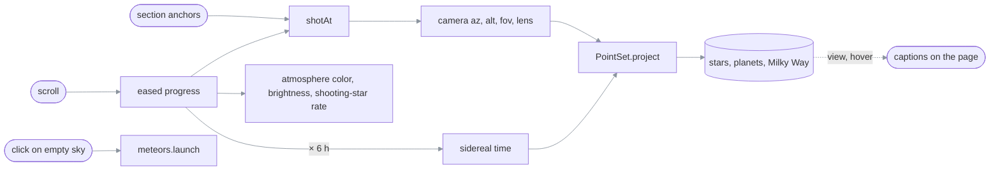
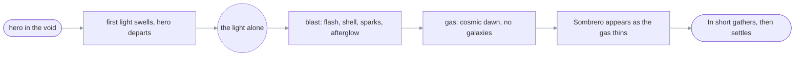
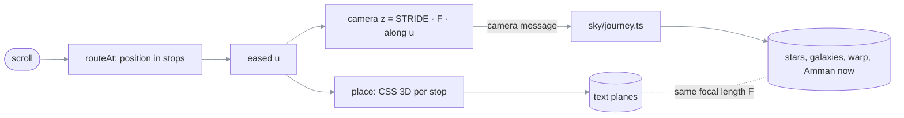
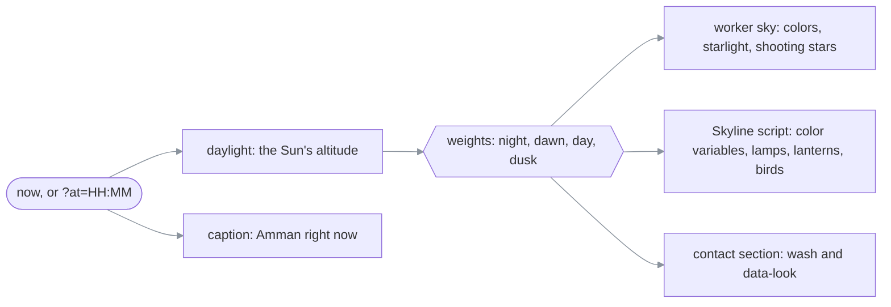
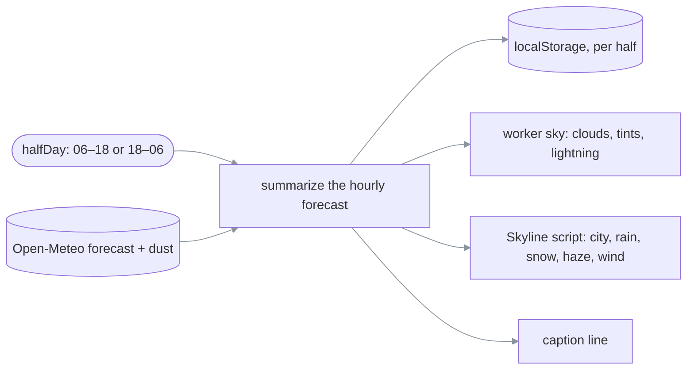

# ezzohamdan.github.io

> **What this is:** the source of Ezzaldeen Hamdan's personal site, served at
> <https://ezzohamdan.github.io/> (English) and <https://ezzohamdan.github.io/ar/> (Arabic).
> **How to read it:** cheat sheet → §1 build and deploy flow → §2 code map → §3 how the sky works →
> §4 change recipes → §5 failure messages → §6 sharp edges → §7 decisions.
> **Reflects code as of 2026-11-13** (`main`, with the `even-scroll` work: an even glide through
> every stop, a longer beginning with a passage through nebula gas, the blast imploding on the way
> back, a lighter blast for Safari, the footer laid over the city, and a photographed Earth, §3b).

**What must not break:**

- **One source of truth:** every fact lives in `src/data/profile.ts`. Pages, JSON-LD, `llms.txt`,
  `llms-full.txt` and the sitemap are generated from it. Never hand-edit a fact into a component.
- **Each language stands alone:** English pages show no Arabic text, and Arabic pages never show
  the English name. `npm run check` fails the build if either rule breaks.
- **Drafts never ship:** a post with `draft: true` is never built for production.

## Cheat sheet

| Task | Command |
| --- | --- |
| Install (Node ≥ 22.12) | `npm ci` |
| Develop with live reload (drafts visible) | `npm run dev` → <http://localhost:4321> |
| Production build to `dist/` | `npm run build` |
| Check the build (links, JSON-LD, hreflang, language rule, drafts) | `npm run check` |
| Preview the production build | `npm run preview`, then stop it with `npx astro preview stop` |
| See Amman at another hour (§3c) | Add `?at=HH:MM` (Amman time), e.g. <http://localhost:4321/?at=21:00> |
| See Amman in any weather (§3d) | Add `?weather=` (`clear`, `partly`, `cloudy`, `fog`, `drizzle`, `rain`, `storm`, `snow`, `dust`, optionally `,windy`), e.g. <http://localhost:4321/?weather=snow&at=21:00> |

**Limits:**

- **JavaScript:** about 10 KB gzipped on first load (the sky's page side and the journey
  choreography). The sky worker, including the 5,044-star catalog (every naked-eye star, to
  magnitude 6), the planet ephemeris, the land map and both renderers, is about 58 KB gzipped and
  loads after the page has painted. Everything else is HTML and CSS.
- **The galaxy journey** needs a window at least 900 × 560 px with motion allowed
  (`journey.ts::JOURNEY_QUERY`); everything else gets the dome.
- **The Earth's photographs** (`src/assets/earth/`, about 350 KB) are fetched only in the galaxy
  journey, once the reader is past the first title; until then, and if they fail, the globe is
  the drawn map.
- **Fonts:** fetched from Fontsource at build time, so a build needs network access.
- **Hosting:** GitHub Pages serves static files only; there is no server code anywhere.
- **One outside service:** Amman's weather comes from Open-Meteo, fetched by the visitor's browser
  (§3d). It is the site's only request to a third party, at most twice a day per visitor, so the
  visitor's IP address reaches Open-Meteo. If it fails, the scene simply has no weather.

## 1. Build and deploy flow

```text
src/data/profile.ts ──┐
src/content/blog/*.md ┤  npm run build   ┌─ index.html, ar/index.html, 404.html
src/components, pages ┼────(astro)──────►│  robots.txt, sitemap.xml, llms.txt, llms-full.txt
public/ (CV, og, ...) ┘                  └─ _astro/ (css, ~5 KB js, fonts, webp logos)
                                                     │
                                          npm run check (fails on any violation)
                                                     │
   push to any branch ──► GitHub Actions: build + check ──► main only: deploy to Pages
                                                                      └─► ping IndexNow
```

#### 1. (rendered)


Read it as: the only way onto the live site is a push to `main` whose build passes the check;
nothing deploys from a feature branch.

> **Required:** the repo's Pages source is set to **GitHub Actions**
> (Settings → Pages → Build and deployment).
> **Prohibited:** committing `dist/`, and editing generated files such as `sitemap.xml` by hand.
> **Async:** the IndexNow ping runs after the deploy; if it fails, the deploy still stands.

## 2. Code map

| What | Source |
| --- | --- |
| All content, both languages | [`src/data/profile.ts`](src/data/profile.ts) |
| UI strings, month names, date formats | [`src/lib/i18n.ts`](src/lib/i18n.ts) |
| JSON-LD graph (`Person`, `ProfilePage`, `SoftwareSourceCode`, `BlogPosting`) | [`src/lib/schema.ts`](src/lib/schema.ts) |
| `llms.txt` / `llms-full.txt` text | [`src/lib/llms.ts`](src/lib/llms.ts) |
| Profile page (used by both languages) | [`src/components/ProfilePage.astro`](src/components/ProfilePage.astro) |
| `<head>`: meta, Open Graph, hreflang, fonts | [`src/layouts/Base.astro`](src/layouts/Base.astro) |
| Sky: page side (picks the dome or the journey, scroll, section anchors, captions, star names, wishes) | [`src/components/Sky.astro`](src/components/Sky.astro) |
| Sky, the dome: atmosphere colors, drawing, twinkle, scroll dimming, shooting-star rate, wishes | [`src/scripts/sky/renderer.ts`](src/scripts/sky/renderer.ts) (runs in [`worker.ts`](src/scripts/sky/worker.ts)) |
| Galaxy journey, page side: stops, scroll track, plane choreography, the camera, nav and focus | [`src/scripts/journey.ts`](src/scripts/journey.ts) |
| Galaxy journey, sky side: star field, galaxies, warp, takeoff and landing | [`src/scripts/sky/journey.ts`](src/scripts/sky/journey.ts) (same worker) |
| Galaxy portraits (Andromeda, Triangulum, Whirlpool, Sombrero, Milky Way) and the Sun's place in the Milky Way | [`src/scripts/sky/galaxies.ts`](src/scripts/sky/galaxies.ts) |
| The nebula gas after the Big Bang: clouds painted from warped noise, the sheets the camera flies through, newborn stars | [`src/scripts/sky/nebula.ts`](src/scripts/sky/nebula.ts) |
| The globe at the end (lit for the moment the sky starts; drawn map first, photographs once fetched) | [`src/scripts/sky/earth.ts`](src/scripts/sky/earth.ts) |
| The globe's photographs (NASA, public domain; 2048 × 1024, see Credits) | [`src/assets/earth/`](src/assets/earth/) |
| Land map for the globe's drawn fallback (generated, do not edit) | [`src/data/earth.json`](src/data/earth.json) ← [`scripts/make-earth-map.mjs`](scripts/make-earth-map.mjs) |
| Sky: Amman, sidereal time, Sun, planets, galactic plane, the moment shown | [`src/scripts/sky/astro.ts`](src/scripts/sky/astro.ts) |
| Sky: catalog arrays, the camera and its lens, the projection | [`src/scripts/sky/catalog.ts`](src/scripts/sky/catalog.ts) |
| Sky: shooting stars (one shared direction, tapered trails) | [`src/scripts/sky/meteors.ts`](src/scripts/sky/meteors.ts) |
| Sky: Milky Way | [`src/scripts/sky/milky-way.ts`](src/scripts/sky/milky-way.ts) |
| Star, planet and shower names (both languages) | [`src/data/sky-names.ts`](src/data/sky-names.ts) |
| Star catalog (generated, do not edit) | [`src/data/sky.json`](src/data/sky.json) ← [`scripts/make-sky-catalog.mjs`](scripts/make-sky-catalog.mjs) |
| Amman's weather: the half-day it is for, fetching and caching, the snow rule, `?weather=` previews, the caption line | [`src/scripts/weather.ts`](src/scripts/weather.ts) |
| Amman's weather in the sky: clouds, overcast, dust and fog tints, the veil over stars, lightning (both renderers) | [`src/scripts/sky/weather.ts`](src/scripts/sky/weather.ts) |
| Amman at its real time of day (Temple of Hercules, King Abdullah I Mosque, the Abdali towers, the Roman Theatre, stone houses with their rooftops and balconies, trees behind them, minarets, beacons, pigeons, window lights; a color per time of day and the script that blends them, §3c) | [`src/components/Skyline.astro`](src/components/Skyline.astro) |
| House of Wisdom diagram | [`src/components/Council.astro`](src/components/Council.astro) |
| Blog schema and routes | [`src/content.config.ts`](src/content.config.ts), [`src/pages/blog/`](src/pages/blog/) |
| Post-build checks | [`scripts/check-dist.mjs`](scripts/check-dist.mjs) |
| CI and deploy | [`.github/workflows/deploy.yml`](.github/workflows/deploy.yml) |

## 3. How the sky works

The sky has two modes, chosen once per page load:

| Mode | Where | Section |
| --- | --- | --- |
| **The galaxy journey:** scrolling flies forward through space, past real galaxies, with the content on planes along the route | Profile pages on windows at least 900 × 560 px with motion allowed | §3b |
| **The dome:** the real sky over Amman, turning with scroll | Phones, short windows, reduced motion, article pages | §3a |

The inline script in `Base.astro` sets `html.journey` before first paint when the profile page
qualifies; `Sky.astro` reads that class and tells the worker which renderer to build.

### 3a. The dome

The page is a journey through the real sky over Amman, seen as a dome. The sky holds every
naked-eye star (to magnitude 6), the naked-eye planets and the Milky Way, positioned for right now (or 21:00 tonight
if it is daytime in Amman). Stars twinkle; planets shine steadily, as in the real sky. Scrolling
moves two things:

- **Time:** the whole page spans six hours of sky rotation around Polaris (90°).
- **The camera:** each section is a *shot*, each zoomed a little deeper than the last. The camera
  holds while you read a section and glides to the next shot as the next section begins, with a
  gentle push-in. Every move takes the same scroll distance (about one screen), so no move is
  faster than another. Like a telescope, zooming in reveals fainter stars (one magnitude per
  doubling of magnification).

Everything is eased, and nothing ever leaves trails. Scroll also sets the atmosphere color, the
sky's brightness and the shooting-star rate. Clicking empty sky makes a wish.

| Section | Shot (`renderer.ts::SHOTS`) | Caption |
| --- | --- | --- |
| `hero` | Straight up, the whole dome (lens 1, stereographic) | The hero caption: "The sky over Amman right now, 21:18" |
| `about` | Tilted toward the south | Overhead or south: the nearest named star |
| `experience` | The southern sky | "Looking south: …" |
| `projects` | East, where new stars rise | The brightest planet in view, if any |
| `education` | North, toward Polaris | "Looking north: Polaris" |
| `contact` | Down to the eastern horizon over Amman (lens 0.12, near-rectilinear), its sky at Amman's real time of day (§3c). The horizon follows the skyline's live position, so the camera lowers its gaze as the city rises into view | "Amman right now, 20:47" |

```text
Sky.astro ── scroll 0..1 + skyline's horizon y now ─► worker: eased progress (time constant ≈ 0.22 s)
          └─ "scenes": where each section starts (px)  │
                                            ├─► time = now + progress × 6 h ──► sidereal time ─┐
                                            ├─► shot = SHOTS[section], gliding between ─► camera()┤
                                            │                                                     ▼
                                            │              PointSet.project: stars, planets, Milky Way
                                            ├─► atmosphere color · sky brightness · shooting-star rate
worker ── "view" (what is in the center), "hover" (star or planet name) ──► captions on the page
click on empty sky ─► worker: meteors.launch(x, y)
```

#### 3a. (rendered)



Read it as: scroll moves the sky only through time and the camera. The dome turns, and the
camera looks somewhere new for each section. No text is ever drawn on the canvas; every caption
is DOM text in `Sky.astro`.

> **Guaranteed:** no trails are ever drawn. In reading shots no ground shows (`resolve` tilts the
> camera up until the whole horizon is off screen); only the contact shot shows the horizon.
> **Prohibited:** long-exposure trails or anything else that accumulates behind text (§7).
> **Reduced motion:** a still overhead sky (no rotation, camera moves, twinkle, shooting stars or
> wishes). The atmosphere color still follows scroll, since it is color, not motion.
> **Calm** (article pages, `<Base calmSky>`): a still overhead sky in a fixed midnight color, half
> brightness, rare shooting stars and no wishes.

**Text on the dome:** content blocks curve away and fade at the top and bottom of the screen and
are flat through the middle, where they are read (`global.css`, `dome-curve`, CSS scroll-driven,
written in longhand like the other scroll-driven rules).

**Tunables** (`src/scripts/sky/renderer.ts` unless noted): shots are the `SHOTS` table; the
atmosphere colors are the `ATMOSPHERE` table; brightness is the `dim` line in `render`; the
rotation span is `DOME_SPAN` and its glide is the `4.5` in the progress easing; the shooting-star
rate is the `rate` line (`0.25 + 2.2 * smooth(0.5, 0.97, p) ** 1.5`); meteor lifetime and speed
are in `meteors.ts::spawn`, and the shared direction is `DX`/`DY`.

### 3b. The galaxy journey

Scrolling flies a camera straight ahead through space. It only ever moves forward: no pans, no
rolls, no zoom. That is the point of this mode. In the dome, a fast scroll swung the camera between
five directions and zoom levels, which read as disorganized; here a fast scroll is just faster
flight.

Every `[data-stop]` element in `ProfilePage.astro` is a **stop**: the hero, each section title
(`data-stop="title"`) and each block of content (`data-stop="panel"`). Stops are fixed to the
screen and moved with CSS 3D transforms; the sections stay in the document only as the scroll
track, so anchors, the header highlight, search engines and screen readers see the normal page.
Every stop does the same three things (the first leg, from the hero to the first title, bends
this rule for the beginning; see below):

| Phase | Plane | Camera |
| --- | --- | --- |
| **Arrive** (from 4 focal lengths away) | A content stop's parts are fixed in space beside the route (below); perspective alone grows them and carries them outward to their sides, and cards "render" in from top to bottom. Titles come straight down the middle and assemble from points of starlight. | Glides forward one `STRIDE` |
| **At the stop** | Flat and crisp: the card on the stop's side, turned 10° toward the route, the visuals on the other side. Nothing else is visible. Titles are flat and centered. Within `SETTLED` (5% of the way in or out) it counts as settled: clickable, no mask, letters at rest | Slows to half its average speed (`EVEN`), the text to a quarter (`TEXT_EVEN`); neither ever stops |
| **Depart** | The parts pass out of view on their sides, nearest first, as the camera goes on. Titles rise overhead; the hero sinks away below and tilts like the ground at takeoff, over a longer first leg (`WEIGHT.hero`) | Moves on |

The galaxies come **farthest first**, so the whole flight is a return to Earth (owner's request):

| Section | Passes (`sky/journey.ts::DESTINATIONS`) | From Earth (`journey.ts::DISTANCE`) | Space tinted |
| --- | --- | --- | --- |
| `hero` | The void before the beginning: pitch black. Leaving it, the beginning (below): a first light swells, the Big Bang, and a new universe grows out of it | "13.8 billion years ago" | Black, then the blast's embers |
| `about` | The Sombrero, its dust lane edge-on | 31 million light-years | Amber |
| `experience` | The Whirlpool and its companion NGC 5195 | 28 million | Magenta |
| `projects` | The Triangulum galaxy | 2.7 million | Teal |
| `education` | Andromeda, al-Sufi's "little cloud", with M32 and M110 | 2.5 million | Violet |
| *(after the last stop)* | The homecoming, below | 100,000 light-years, 4 light-hours, 22,000 km | Space, then Amman's sky |
| `contact` | Amman at its real time of day (§3c): shooting stars while its sky is dark, some falling behind the skyline, as in the dome | (home) | Night, dawn, day or dusk |

Each galaxy is far behind its section's title, grows as the section is read, and is passed close
by on the way to the next title. The caption at the bottom names it and gives the distance from
Earth, which counts down on a log scale between places (`journey.ts::distanceAt`, units from
millions of light-years down to km in `formatDistance`), slowest at each stop.

**The beginning** (`sky/genesis.ts::GENESIS`, `sky/journey.ts::drawGenesis` and `drawDust`,
`sky/nebula.ts`, owner's request, 2026-11-07). The hero is the void, pitch black, and the first
leg, from the hero to the "In short" title, tells how it all started. That leg is about 2.8
screens of scroll (`WEIGHT.hero`), so 0.1 below is a little over a quarter of a screen; positions
along the route in stops:

| From | To | On screen | Page |
| --- | --- | --- | --- |
| 0 | 0.012 | Nothing: pure black | The hero |
| 0.012 | 0.175 (`glow`) | A small light appears as soon as the page moves and swells, brighter and more restless, faint spikes around it | The hero departs from 0.031, gone by 0.157 (`hero`); caption "The beginning, 13.8 billion years ago" from 0.07 (`caption`) |
| 0.175 | 0.279 (`bang` + `blast`) | The Big Bang: a flash from white to gold to ember red, a soft shock shell, sparks thrown out, the young universe's mottled afterglow cooling, which lingers into the gas; its stars light up through it | Nothing on screen but the sky |
| 0.175 | 0.357 (`born`) | The new universe grows out of the center to full size | Nothing |
| 0.221 | 0.661 (`dust`) | The gas (`nebula.ts`): eleven sheets of nebula the camera flies through, each a cloud of filaments, knots and dark dust lanes that fills the view, with no opening along the line of flight. The first condense out of the blast's haze in its own gold and ember; after them rose, magenta, violet and blue weave through each other, six or seven sheets showing at once; newborn stars inside. It has the stage to itself: no galaxy shows and the stars are dimmed to a quarter behind it | Caption "Cosmic dawn, the first stars, 13.7 billion years ago" from 0.28, as the blast ends (the first stars lit some 100 to 200 million years after the Big Bang), until 0.69 |
| 0.554 | 0.696 (`cosmos`) | As the gas thins, the galaxies appear, the Sombrero first, and the stars return to full | Nothing |
| 0.696 | 0.964 (`title`) | The Sombrero ahead | "In short" gathers over about three quarters of a screen, as any title does, then settles |

```text
u  0 ─ 0.031 ── 0.157 ─ 0.175 ──── 0.279 ──── 0.554 ── 0.661 ── 0.696 ───── 0.964 ── 1
   void │ light swells ───┤ blast ───┤
        │ hero departs ┤   │ universe grows ─┤ (to 0.357)
                             │ gas: gold, ember, then rose, magenta, violet, blue woven ┤
                                              │ Sombrero appears ─┤
                                                                   │ "In short" gathers ┤ settles
```



Read it as: the blast plays between the hero leaving and the title gathering, so no text is ever
over the flash; the gas runs on from the blast in its colors and owns its stretch, and the
Sombrero arrives alone before the first words.

**Scrolling through it is paced too** (`journey.ts::throughBang`): over the first leg (to the end
of `BLAST_OUT`), each step of the eased camera is held to the menu jumps' pace (`paceAt`), so a
flick plays the beginning out instead of crossing it in a tenth of a second, which also kept the
flash from brightening. The camera then catches up with the scroll. The blast once spanned 0.56
to 0.78 of a one-screen leg; the owner found it too fast to read and asked for it fleshed out
(2026-11-08). Then "In short" gathered between 0.74 and 0.8 of that leg, a twentieth of a screen
right on the flash's heels, and read as rushed next to every other title (2026-11-13): the leg
grew, keeping the blast's scroll length, first to two screens with a short passage of gas, then
to 2.8 so the gas has its own shot without the Sombrero in it (owner's request, the same day).
`PACED.GENESIS_MS` and `STILL_MS` grew with it, so the blast still takes the same time. The page
side reads the same `GENESIS` positions (`journey.ts::render`, the `genesis` branch), which is why
the hero departs faster than any other stop.

> **Guaranteed:** the flash can only brighten at `FLASH_RISE` (3.2 a second) and fade at
> `FLASH_FALL` (5), so scrolling back and forth over it can't strobe. A menu jump through it slows
> down and plays it in full (§3b, "Focus and links"). Going back toward the hero, by a jump or by
> scrolling up, plays it backwards as an implosion, drawn by the same code from the same `u`: the
> shock ring closes in, the sparks fall back, the flash gathers into the point and the light
> shrinks into the void (owner's request, 2026-11-13). Scrolling up goes `REWIND` (2.5) times the
> forward pace everywhere but the blast, which keeps its own pace so the implosion can be seen;
> the hero is back about a second after the reader reaches the top. Only a reader's fast flick
> skips it (`intact`, by camera speed). The light is
> drawn where the camera looks (`cx`, `cy`), so it lines up with the title that follows. Nothing
> else is drawn in the void: no stars, no shooting stars, and clicks make no wishes there. The
> journey has no hero caption (`.journey .sky-caption`); "The sky over Amman right now" belongs
> to the dome. The page is black from its first paint (`.journey body`), and so are the header's
> glass and the browser's theme color (`Base.astro`'s inline script): before, the midnight blue
> showed for most of a second until the sky's first frame, and the header stayed blue over the
> void.

**The scroll cue** (`#scroll-cue`, owner's request). The first screen otherwise looks like a
static page, so the hero ends with "Scroll to begin the journey" beside a line that a point of
light falls down. It is part of the hero block, not fixed to the screen: fixed, it ran into the
hero's stats on short windows, and inside the block it shrinks with the hero to fit. It fades out
as the hero starts to leave (`journey.ts::cue`) and returns at the top. The dome never shows
it; there the page scrolls like any other.

**Stops as places in space** (`journey.ts::placeParts`, owner's request). A content stop is a
see-through frame whose `[data-part]`s are fixed at points beside the route, given in
`ProfilePage.astro` as `data-at="x,y,depth"` (x in viewport widths toward the stop's side, y in
viewport heights, extra depth in focal lengths). The card goes on the stop's side; visuals go on
the other side, farther away, so they move with real parallax: each organization's logo on a
planet in its brand color (`BRAND`) ringed by a full orbit, the House of Wisdom diagram, the
certificates, and four "In short" facts floating on their own (the other facts are hidden in the
journey but stay in the page). Roles show two highlights per group until "Show all highlights"
(`.more`). The mouse leans the camera a little (`lean` message), so near parts shift more than
far ones and the sky leans the same way. Cards lift a little on hover. Only visuals bob; text
never moves on its own.

**Space never freezes.** When the reader stops scrolling, the camera keeps a slow drift (`sky/journey.ts`, `dz`,
`dx`, `dy`, `breath`): near stars shift more than far ones and galaxies swell slightly. In the
homecoming the planets start where they really are and then orbit (Mercury about every 24 s), and
the marked places ripple. The hero's real sky and Amman's don't drift; they twinkle instead.

**The homecoming** (`sky/journey.ts::drawHomeBack`, `drawHomeFront`). After the last stop come
three more stops with no text (`journey.ts::HOME_STAGES`), each slowing like any stop. The camera
slows to a creep and the motion becomes a powers-of-ten zoom (`ZOOM` = 14× per stage), always
closing in on the next destination at the center of the screen:

| Stage | What is on screen |
| --- | --- |
| `milkyway` | The Milky Way, centered on the Sun's place in the Orion Arm (`galaxies.ts::SUN_IN_MILKY_WAY`), marked with a brass ring |
| `sun` | The Solar System, all eight planets where they really are right now (`astro.ts::solarSystem`; Uranus and Neptune from the same JPL table, too faint to be in `PLANETS`), orbits on a square-root scale so the inner planets aren't crowded into the Sun |
| `earth` | The zoom moves from the Sun to Earth, which grows out of its dot into a globe centered on Amman, lit for this moment (`astro.ts::subsolarPoint`), so Amman is on its real side of the line between night and day, marked in brass; the caption names that side (`journey.ts::EARTH_CAPTIONS`). The globe is photographed (owner's request, 2026-11-13): NASA's Blue Marble by day, its Earth at Night on the dark side, city lights brightened (`earth.ts::LIGHTS_BOOST`) |
| landing | The globe grows a little and fades into Amman's sky as the contact section and the skyline scroll in |

The Solar System is turned so the Sun lies on the same side of Earth as the daylight on the globe.

```text
scroll ─► journey.ts: routeAt(scrollY) = position in stops (u)
            │  eased (LAG 0.14 s)
            ├─► place(stop, arrive, depart): CSS perspective(F) transform, opacity, --r, --a
            │       (F = 0.72 × viewport width, the same focal length the stars use)
            └─► "camera" message per frame: z = STRIDE·F·along(u), speed, u, landing, skyline y
                     ▼
worker: sky/journey.ts ─► background (night → space → Amman now) · tint per section
                       ─► galaxies (sprites painted once, galaxies.ts) · star field (real + generated,
                          recycled) · warp streaks only when fast · shooting stars (hero, Amman
                          while its sky is dark)
```

#### 3b. (rendered)



Read it as: one eased number drives both the text planes and the stars, through one focal
length, so text and space move as one. Nothing on the canvas depends on where the text is.

> **Guaranteed:** every bit of scrolling moves the scene (owner's request, 2026-11-13): the
> camera never goes below half its average speed (`EVEN`) and the text below a quarter
> (`TEXT_EVEN`), so no stop is a dead zone to scroll through. When the reader stops scrolling,
> everything stops with them (eased, `LAG`), and near a stop no other stop is visible. Cards are
> turned 10° toward the route and have no mask once settled (`SETTLED`); a part too tall for the
> screen is pushed back until it fits. Warp streaks fade in only above 6 focal lengths of travel
> a second (the `warp` line), so an unhurried scroll barely streaks and nothing streaks while the
> reader reads.
> **Prohibited:** camera pans, rolls or zooms between sections (the reason this mode exists), and
> anything that accumulates behind text (§7).
> **Focus and links:** a link (the header, the name) or keyboard focus aimed at a stop more than
> one away makes a single **jump** (`journey.ts::flyTo`): the plane being read leaves, the camera
> crosses the distance in one smooth move (`glide`, 1.1 to 2.4 s) with every plane in between
> hidden and the galaxies dimmed, and only the destination arrives. The page scrolls along, so the
> header highlight and the address stay right; any wheel, touch or key press takes over. A
> neighbouring stop is an ordinary smooth scroll, unless either end is the hero's leg (`u` < 1) or
> the homecoming (past the last stop): those always fly, however short, because scrolled through
> they replayed the Big Bang or the dive home at speed. Those jumps are **paced**
> (`journey.ts::planPace`): each part of the route gets its own time per unit (`PACED`, by
> `paceAt`): about 5.5 s per stop through the light and the Big Bang (whose leg is 2.8 screens),
> 2.1 s per stop through the gas after it (`DUST_MS`: at the blast's pace it dragged while
> everything else flew, owner's report, 2026-11-13), 0.9 s per homecoming stage, 0.9 s for the
> landing, and open space crossed fast. A jump between the hero and "Where I've worked" takes
> about 3.4 s either way. Between them `paceAt` changes speed as under a steady push, its speed
> squared blending evenly with distance; a straight blend of the pace held the camera still after
> the Big Bang and then lurched it forward. From the end of the gas it speeds up to open space
> (`BLAST_OUT`). The flight then cruises at an even speed with soft ends (`cruise`) rather than
> the smootherstep, which had rushed through the middle. In a paced flight the camera
> (`flightZ`) and the dive home don't slow down at stops and stages, and planes arrive and leave
> by distance along the route rather than by the clock.
> A reload returns to the same place.

```text
open-space jump:  y ─── glide(t) ───────────────────────────────► y1      (1.1–2.4 s)
paced jump:       time shares ∝ paceAt(u):  [Big Bang ▓▓▓▓▓][open ░][home ▓▓▓][land ▓]
                  cruise(t): soft start ─ even speed ─ soft stop          (up to 7 s)
```

Read it as: a paced jump spends its time where there is something to watch, and never speeds up
in the middle of it.

**Tunables** (`src/scripts/journey.ts` unless noted): `EVEN` and `TEXT_EVEN` (how evenly the
camera and the text move: their slowest speed at a stop, as a share of the average), `SETTLED`,
`STRIDE` (camera travel and arrival distance per stop), `PACE` (scroll per stop) and `WEIGHT` (its
share per kind of stop; the hero's sets the beginning's length), `HOME_WEIGHT` (scroll per
homecoming stage), `LAG` (camera easing); the beginning's timing is `sky/genesis.ts::GENESIS`, its
nebula is `SHEETS`, `PALETTES`, `DEPTH` and `paint` in `sky/nebula.ts`; the arrive and
depart paths are in `place`, a jump's duration is the `ms` line in `flyTo`, and the places'
distances are `DISTANCE`. The parallax depths are the `--depth` and `calc(var(--px) * …)` values in
`global.css` (the galaxy journey block). The idle drift's amplitudes are the `dz`, `dx`, `dy` lines
in `sky/journey.ts::render`. The homecoming's
zoom is `homeLevel`, `ZOOM` and `ECLIPTIC_TILT` in `sky/journey.ts`; the globe's colors are at the
top of `sky/earth.ts`. In `src/scripts/sky/journey.ts`:
`DESTINATIONS` (galaxy, side, tint), the galaxy offsets in `placeGalaxies`, warp is `EXPOSURE`,
`MAX_STREAK` and the `warp` line, and the sky colors are `NIGHT`, `SPACE`, `PREDAWN`, `DAWN`. Each
galaxy's look is its branch in `galaxies.ts::paintGalaxy`.

### 3c. Amman at its real time of day

The last scene (`#contact`) shows Amman as it is right now (owner's request, 2026-11-07): night,
dawn, day or dusk, from the Sun's real height there. Both modes do it. Only the dome's hero
(phones) keeps showing "tonight at 21:00" in daylight; the journey's hero is the void.

`astro.ts::daylight(ms)` turns the Sun's altitude into four weights that sum to 1, so the scene
drifts from one look to the next over an hour or so, as the real light does, instead of switching
at set times:

| Sun's altitude | Weights | What the scene shows |
| --- | --- | --- |
| below −16° | `night` 1 | A dark blue city with 40% of its windows lit and the far hills glittering; the Citadel, the theatre, the mosque and the church floodlit; green minaret lanterns; no pigeons. Stars and shooting stars |
| −16° to −6° | `night` fading into twilight | Windows go out (or come on) a quarter at a time |
| −6° to −2° | twilight 1: `dawn` while the Sun is in the east, `dusk` in the west | Dawn is the original first-light scene, the last lights going out as you scroll. Dusk is the limestone glowing pink, lights coming on |
| −2° to 14° | twilight fading into `day` | The low sun's warm light |
| above 14° | `day` 1 | A blue sky, deep at the top so the contact text reads; bright stone; pigeons. No stars; now and then a faint shooting star (`meteors.ts::DAY_METEORS`, about one in 25 s, at `DAY_METEOR_DIM` brightness) |

In November Amman's sun rises about 07:00 and sets about 17:40 (UTC+3 all year), so `?at=06:45`
shows dawn and `?at=17:50` dusk.

| Piece | Code | How it follows the time |
| --- | --- | --- |
| Sky, journey | `sky/journey.ts::DESCENT`, `HOME`, `STARLIGHT` | Colors, starlight and shooting-star rate blended by the weights, refreshed every 30 s |
| Sky, dome | `sky/renderer.ts::APPROACH`, `AMMAN_SKY`, `STARLIGHT` | The same, as the last two stops of `atmosphere` |
| City | `Skyline.astro`, "Time of day" | Every color is a CSS variable `--c<n>` with four versions (`versions`); the script blends them every minute |
| Window lights | `Skyline.astro::lamp`, `.lamp` in `global.css` | Four tiers (`--t`) that come on as `--lamps` rises |
| Wash over the sky | `.amman-now`, `--wash-*` | Blended by the same script |
| Captions | `journey.ts::ammanNow`, `EARTH_CAPTIONS` | "Amman right now, 20:47"; the Earth stage names Amman's side of the planet |
| Earth in the homecoming | `sky/journey.ts`, `moment` | Lit for the moment the sky starts |

```text
astro.ts::now() ──► daylight(): the Sun's altitude ──► weights { night, dawn, day, dusk }, sum 1
  (real time, or ?at=HH:MM)                              │
     │                                                   ├─► worker sky: colors, starlight, meteor rate
     │                                                   ├─► Skyline script: --c<n> = Σ weight × version
     │                                                   │     --lamps, --lights, --sun, --birds, --wash-*
     └─► captions: "Amman right now, 20:47"              └─► data-look on #contact (day: brighter text)
```



Read it as: one clock and one set of weights drive the sky, the city and the captions, so they
never disagree about the hour. Nothing picks a look from the clock's hour directly.

**Preview any hour** with `?at=HH:MM` (Amman time, today), e.g.
<http://localhost:4321/?at=21:00>. The whole page follows it, hero caption included. The worker has
no address of its own; the page passes it the clock's offset at init (`setClockOffset`).

### 3d. Amman's weather

The Contact scene also shows Amman's real weather (owner's request, 2026-11-09): clear, partly
cloudy, cloudy, fog, drizzle, rain, thunderstorm, snow or dust, and wind on top of any of them.
Both modes, every time of day.

**Twice a day, not live** (owner's choice). The day runs 06:00–18:00 in Amman, the night
18:00–06:00 (`weather.ts::halfDay`). Each half is summed up from Open-Meteo's hourly forecast across
all of it (`summarize`), so an evening visitor sees the night Amman is having, and everyone in the
same half sees the same weather. A visitor fetches once per half (`localStorage`,
`amman-weather:<date>-<day|night>`); an open page fetches again when the half changes.

| Weather | Rule over the half-day (first match wins) | Scene |
| --- | --- | --- |
| `storm` | A thunderstorm code (95–99) and at least 0.2 mm | Dark overcast, heavy rain, lightning now and then (a flash, sometimes a bolt behind the city) |
| `snow` | Snowfall, or ≥ 0.5 mm in hours at **≤ 5 °C by day, ≤ 4 °C at night** (`SNOW_AT`, the owner's rule) | Pale overcast, snow falling, roofs white (`.snowcap`) |
| `rain` | ≥ 1 mm | Grey sky, rain, darker wetter stone, no pigeons |
| `dust` | Dust ≥ 80 μg/m³ near the ground (`DUST_UG`) | Golden-brown sky and air, the far hills fading |
| `drizzle` | ≥ 0.2 mm, or a drizzle code | Overcast, light rain |
| `fog` | A fog code, or visibility under 1 km | Grey-white sky, mist banks drifting across the hills |
| `cloudy` / `partly` / `clear` | Mean cover ≥ 65% / ≥ 25% / less | Clouds over the whole sky, more and greyer as the cover grows |
| windy (with any) | Gusts above about 50 km/h | Groves sway, rain and snow lean with the wind, clouds drift faster, pigeons stay in |

```text
Open-Meteo hourly forecast ──┐                        ┌─► worker sky: clouds, tints, veil, lightning
  (+ dust, air-quality API)  ├─► summarize(half) ─────┼─► Skyline script: city colors, snow caps,
halfDay(): 06–18 or 18–06 ───┘   cached per half       │     rain, snow, haze, mist, wind (.weather-front)
                                  null on failure ─────┴─► caption: "Rain tonight, windy"
```



Read it as: one weather per half-day feeds the sky, the city and the caption, and a failure at
any step leaves the scene exactly as it was before weather existed.

**What the weather touches:** the sky's colors (`sky/weather.ts::weatherSky`, in both renderers),
clouds drawn across the whole sky (`createWeatherSky`, softer behind the contact text at
`TEXT_VEIL`), the starlight and shooting stars (dimmed by `veilOf`), the city's colors
(`Skyline.astro`, `weathered`), and a layer in front of the city for rain, snow, haze and mist
(`.weather-front`). That layer starts just under the contact text (`placeFront`), so rain and snow
never fall behind words. The caption gets a second line ("Rain tonight, windy"), and the footer
credits Open-Meteo, as its CC BY 4.0 licence requires.

**Preview** with `?weather=` (see the cheat sheet), alone or with `?at=`. A preview skips the
network and the cache.

## 4. Change recipes

**Update a fact (role, date, project, number):**

1. Edit it in `src/data/profile.ts`, in **both** `en` and `ar`.
2. Bump `site.updated`. It feeds the sitemap `lastmod`, the JSON-LD `dateModified` and the footer.
3. Verify with `npm run build && npm run check`.

**Add a project:** append to `projects` in `profile.ts`, with a `repo` if it has one; the JSON-LD
picks it up automatically. Set `featured: true` on at most one project, since it takes the
full-width card.

**Publish a blog post:**

1. Add `src/content/blog/<slug>.md` with `title`, `description`, `date`, `tags` and
   `draft: true`.
2. Preview it with `npm run dev` at `/blog/<slug>/`.
3. Flip it to `draft: false` to publish. `/blog/` and the sitemap entry appear automatically with
   the first published post.

**Add a degree** (one is anticipated): append it to `degrees` in `profile.ts`, newest first, with
its logo in `src/assets/logos/` and its university in `orgs`; give the org a planet color in
`ProfilePage.astro`'s `BRAND` (and add it to `DEEP` if its logo is light line art). It becomes its
own stop in Education, the newest degree becomes the "Education" fact, and JSON-LD and
`llms-full.txt` pick it up. `end: null` shows "Present". Verify on a wide window and a phone.

**Add a block of content to the journey:** put `data-stop="panel"` on its outermost element (or
`data-stop="title"` on a section's `<h2>`), inside a `<section id>` in `main`. Keep it under one
screen tall at 1440 × 800; a taller plane is pushed back until it fits, which shrinks its text. A
section with stops but no entry in `sky/journey.ts::DESTINATIONS` simply has no galaxy. Verify by
scrolling to it in `npm run dev` on a wide window: it should hold flat and centered, with nothing
else on screen.

**Change the sky:** see the tunables in §3a and §3b. Then check, in this order:
1. Reduced motion (macOS: System Settings → Accessibility → Display → Reduce motion): a still
   sky with no shooting stars.
2. An article page in `npm run dev`: a dimmer sky.
3. A scroll from top to bottom: text stays easy to read, and shooting stars build at the end.
4. A narrow window (under 900 px) for the dome, and a wide one for the journey, including a fast
   flick across several stops: planes dim, stars streak briefly, and the stop you land on is crisp.

**Change how Amman looks at a time of day:** the city's light is `LIGHTING` (multipliers and a
lift toward white), `AIR` and `FIXED` in `Skyline.astro`; the sky's is the two tables in each
renderer (`sky/journey.ts::DESCENT` and `HOME`, `sky/renderer.ts::APPROACH` and `AMMAN_SKY`, kept
equal). Verify with `?at=21:00`, `06:45`, `10:00` and `17:50`, on a wide window and a narrow one,
in both languages: the contact text must stay easy to read on every sky.

**Add something to the skyline:** draw it with `rect`, `poly`, `line` and the rest, and its colors
follow the time of day by themselves. A landmark Amman floodlights at night goes between
`kind = 'flood'` and `kind = ''`. A new gradient stop or pattern color goes through `def()` in `D`,
never a raw `stop-color` or `fill` attribute (§6).

**Change how a weather looks:** sky colors and clouds are in `src/scripts/sky/weather.ts` (`GREY_*`,
`SNOW_*`, `DUST_*`, `FOG_LOW`, `CLOUD_*`); the city's are `DUST_AIR`, `FOG_AIR`, `SNOW` and
`weathered` in `Skyline.astro`'s script; rain, snow, haze and wind are under "Amman's weather" in
`global.css`. When it should happen is `weather.ts::summarize` and its thresholds. Verify with
`?weather=<kind>&at=11:00` and `&at=21:00` on a wide window and a phone: the contact text must stay
easy to read, and nothing may fall behind it.

**Add a named star:** add `{ en, origin, ar }` to `starNames` in `src/data/sky-names.ts`, where
`en` is the catalog's proper name. Regenerate the catalog with the commands at the top of
`scripts/make-sky-catalog.mjs`. The script exits with `named star not found in catalog: <name>`
if the spelling differs (it's "Shedar", not "Schedar").

## 5. Failure messages from `npm run check`

| Message | Meaning | Fix |
| --- | --- | --- |
| `Arabic text on an English page: "…"` | An English page shows Arabic text, including in `alt`, `title` or `aria-label` | Move the string into the `en` side of `profile.ts` or `i18n.ts` |
| `English name on an Arabic page` | "Ezzaldeen" or "Hamdan" is visible on an Arabic page | Use `person.name.ar` |
| `broken link /x/` | An internal `href`/`src` has no file in `dist/` | Fix the path, or add the file to `public/` |
| `invalid JSON-LD` | A `<script type="application/ld+json">` doesn't parse | Check `src/lib/schema.ts` |
| `hreflang: A does not link back to B` | Language alternates aren't reciprocal | Pass the same `alternates` on both pages |
| `draft "x.md" was built into dist/blog` | The draft filter in `src/lib/blog.ts` broke | Restore `import.meta.env.DEV \|\| !data.draft` |
| `expected exactly one <h1>` | A page has zero or several `<h1>` | One per page; sections use `<h2>` |

## 6. Sharp edges

- ⚠ **Scroll-driven CSS is written in longhand on purpose** (`global.css`, "Scroll-driven
  motion"). The CSS minifier folds `animation-timeline` into the `animation` shorthand, browsers
  reject that, and the whole rule silently disappears. Don't "tidy" it back into a shorthand.
- ⚠ **`public/portfolio/index.html` is a redirect stub,** not dead code. The old URL
  `/portfolio/` is still printed in the CV and on other profiles.
- **`public/a89a…f4.txt` is the IndexNow key.** It's public by design; the protocol verifies site
  ownership by fetching it.
- **Everything is crawlable** (`src/pages/robots.txt.ts`), AI crawlers included. That's
  deliberate for a personal site.
- **The sky runs in a Web Worker** via `OffscreenCanvas`. Browsers without it fall back to the same
  renderer on the main thread, which is why `sky/renderer.ts` is imported in two places.
- ⚠ **`src/data/sky.json` is generated.** Hand edits are lost the next time
  `scripts/make-sky-catalog.mjs` runs. It is BSD-3-Clause data (see Credits).
- ⚠ **`fov` in `camera()` is the angle from the center of view to a screen corner,** not half of
  something. For lens 1 the focal length is exactly the old `R / tan(fov / 2)`, so the dome shots
  look identical to before the camera existed; a halved angle once zoomed every shot in about 2×.
- ⚠ **Unlike what you'd expect, the horizon curves up at the sides** in the dome projection when
  the camera tilts, so checking the point straight ahead is not enough to keep ground off screen.
  `horizonTop` samples the whole visible horizon. Drawing the ground from points sorted by x
  instead of by azimuth once striped the whole sky.
- ⚠ **The contact shot follows the skyline live.** `Sky.astro::horizonNow` sends where the skyline's
  horizon line (`data-horizon` in its viewBox) is on screen with every scroll update, and the
  contact shot is re-solved every frame to match. Two traps: the skyline uses
  `preserveAspectRatio="xMidYMax slice"`, so map viewBox y with its real scale, never as a
  fraction of the element's height; and an earlier version solved the horizon only for the very
  bottom of the page, which left a visible band above the city everywhere else. If `.skyline` is
  renamed, the shot falls back to 75% of the screen height.
- **The skyline keeps its own proportions** (`aspect-ratio: 1440 / 420`, capped at 48vh) so wide
  screens don't crop the tallest tower or the columns. Keep landmark tops below viewBox y ≈ 70.
- ⚠ **Ugly on purpose: the skyline is merged by color, layer by layer** (`Skyline.astro`, `layer`,
  `add`). Every shape of one fill in a layer goes into a single path, so hundreds of houses cost a
  few dozen elements; window grids are SVG patterns filled into one rectangle per house, and paths
  move relatively with short numbers. The price: inside a layer, paths paint in the order their
  fill was first used, not shape by shape. So shapes that must overlap belong in separate layers
  (each row of houses is its own layer, back to front), and walls and hills go in a wall pass
  (`rect(…, true)`, `hill`) that paints before every detail; without it, a wall tone first used
  after some windows painted over them and left blank houses. Drawing each house as its own group
  made the inline SVG about 185 KB; this way it is about 200 KB (48 KB gzipped) with full detail,
  the trees and the time of day (about 3,200 night lamps, 5 KB gzipped, and the four palettes,
  4 KB).
- ⚠ **Open-Meteo's weather codes miss Amman's snow.** Its models smooth the terrain, so they
  reported the January 2022 snowstorm (22–30 cm in the city) as "rain at +1 °C". Snow is decided by
  temperature instead (`SNOW_AT`: precipitation at ≤ 5 °C by day, ≤ 4 °C at night, the owner's
  rule from experience). Tested against archived data: the 2022 storm comes out as snow by day and
  night; a cold rainy day like 6 February 2025 (3.7–4.7 °C) also counts as snow by day. Its dust
  model (CAMS, about 45 km) runs low too, so `DUST_UG` is set well below a real storm's levels.
- ⚠ **Rain and snow must stay below the contact text** (the owner's long-standing rule: nothing
  streaks behind words). `.weather-front` is positioned from where `.contact` ends, not by a fixed
  height; a fixed height let rain reach the buttons on some screens.
- **Every weather look degrades to none.** No network, a blocked request, a malformed answer or
  missing hours give `null`, and the scene stays as it was. Never let a weather error throw.
- ⚠ **Every skyline color must go through the palette** (`Skyline.astro`, "Time of day"). Fills
  drawn with `rect`, `poly`, `line` and `blob` do already; a raw `fill` or `stop-color` attribute
  in the markup stays at first light all day and night. Colors are registered (`cv`, `def`) while
  `drawn` and `D` are built in the frontmatter, before the `<svg>`'s own attributes are written;
  a `cv()` called from the template would come too late for `firstLight` and `looks`. `kind` is a
  mode: it applies to everything drawn until it is reset, and it is part of the fill's key, so lit
  and unlit shapes never share a path.
- **The lamps draw from their own random sequence** (`Skyline.astro::P`), like the trees, so
  lighting more or fewer windows (`LAMPS`) never reshuffles the houses.
- **Trees grow behind the houses, from their own random sequence** (`Skyline.astro::grove`, `R`).
  Each grove is its own layer, drawn just before the row of houses in front of it, so the houses
  hide the trunks and the crowns show over the roofs. The trees' random numbers are separate from
  the houses' (`rand`), so adding, moving or removing a tree never reshuffles the city. Crowns are ellipses drawn as two
  arcs (`blob`), the shortest shape path data allows; the trees cost about 7 KB gzipped.
- ⚠ **Planet positions are valid from 1800 to 2050.** They use Standish's approximate Keplerian
  elements (table 1, `astro.ts::ELEMENTS`). After 2050, switch to table 2 (valid 3000 BC to
  3000 AD), which adds correction terms for Jupiter and Saturn.
- **"Empty sky" means "not over actual text"** (`Sky.astro::onSky`). Text blocks are tested
  against their real line boxes, so the space beside a heading counts as sky. Without that, the
  empty-looking area right of the name didn't launch wishes.
- **Jordan has no daylight saving time** (UTC+3 all year since 2022), so `sky/astro.ts` uses a
  fixed offset. If that ever changes, the caption and the 21:00 "tonight" sky drift by an hour.
- **Unlike what you'd expect, east is on the left** of the sky. The projection shows the sky as you
  see it lying on your back with north at the top, the way an astrolabe plate does.
- **Star labels only appear over empty sky** (`Sky.astro`, the `content` selector), so hovering
  text never pops a label in the middle of reading. The journey has no star labels; its stars
  move.
- ⚠ **Journey mode is decided in two places that must agree:** the inline script in
  `Base.astro` (before first paint, so the layout never jumps) and `journey.ts::JOURNEY_QUERY`
  (which reloads the page when the window crosses it, to switch modes cleanly).
- ⚠ **Journey planes are `position: fixed`.** A `transform`, `filter`, `contain` or `will-change`
  on any ancestor of a `[data-stop]` (a section, `.container`, `.projects`, the `<ol>`) makes it
  fixed to that ancestor instead of the screen, and the plane vanishes or jumps. The sections'
  heights are set inline by `journey.ts::layout`; CSS heights on them are overridden.
- ⚠ **Until `journey.ts::layout` runs, the journey has no scroll track.** The sections are zero
  height then, so the contact section (with the skyline) and the footer sit right under the hero
  for the first frames: long enough to see on every load, and longest in dev, where the scripts
  load one by one. `.journey:not(.has-route)` keeps them hidden (not removed, so the route can be
  measured) until `layout` adds `has-route`. Anything new placed in normal flow after the
  sections would flash the same way.
- **Unlike what you'd expect, journey titles are rebuilt by script** (`journey.ts::spell`): the
  `<h2>` holds a screen-reader copy of the text plus one span per letter (per word in Arabic,
  whose letters join) for the starlight assembly. Edit the title in `i18n.ts`, never in the DOM.
- **The stars and the text share one focal length:** `F = 0.72 × viewport width`, used both as the
  CSS `perspective()` of every plane and by the star field (sent in the `route` message). Change
  it in `journey.ts::layout` only.
- ⚠ **`src/data/earth.json` is generated** from Natural Earth by `scripts/make-earth-map.mjs` (the
  commands are at its top; it can also write a PNG preview to check the coastlines). Natural Earth
  polygons wrap across the 180° meridian and Antarctica's wraps around the pole; the script
  unwraps them, and a naive fill once failed on exactly that.
- ⚠ **The profile page's footer is inside the contact section** (`<Footer overCity />`, with
  `role="contentinfo"` since it is no longer the page's last child), laid over the foot of the
  skyline (`.site-footer.over-city`). It keeps to the start side and stops 17rem short of the end,
  where the sky caption (`.sky-view`) sits; on phones, which have no caption, it centers in two
  tight lines. `.amman-now` is exactly one viewport tall (`100svh`), which `journey.ts::layout`
  relies on for the landing to end at the bottom of the page. Blog pages keep the plain footer.
- ⚠ **The globe is painted twice when the photographs arrive** (`sky/earth.ts`, `usePhotos`):
  first from the drawn map, then from the photographs, 48 rows a frame. `done` means a complete
  picture is on the canvas and stays true while the new one is painted; `busy` means rows are
  still being painted. The new picture replaces the old only when complete, so the swap is one
  frame. The photographs are 2048 × 1024, about one pixel per pixel of the globe sprite at Amman.
- ⚠ **Never fill the sky with a fresh gradient every frame.** Safari paints canvas gradients on
  the CPU: at 2× each full-screen radial fill cost about 18 ms, and the blast's flash and shock
  together halved the frame rate for the whole blast (measured in WebKit, 2026-11-13: 36–56 ms
  frames, against at most 8 ms after the fix). The flash, the shock, the new universe's edge and
  each galaxy's tint are painted once (`radialSprite`) and drawn scaled with `globalAlpha`; the
  nebula is drawn into a layer a third of the screen's size (`nebula.ts`, `LAYER`) and stretched
  once. Expensive one-time work is spread over frames before it is needed: the globe and the
  nebula's clouds a band of rows per frame, the galaxy portraits one per frame from the hero
  (`prepareGalaxies`); painted on first use, they all fell right on the bang. Verify a change
  here by timing frames in Playwright's WebKit at `deviceScaleFactor: 2`, not only in Chrome,
  which hid the problem (Chrome stayed at 120 fps).
- ⚠ **After the bang the whole view grows from a point around the center** (`sky/journey.ts`, `scale`), so
  anything that fills "the screen" must fill what the screen would show at full size: the star
  culling bounds (`drawStars`, `reach`). A plain `fillRect(0, 0, w, h)` there showed as a
  shrinking rectangle. The afterglow's blotches, the nebula's clouds and the gradient sprites stay
  inside their textures, or fade to nothing at their edges, for the same reason.
- **The homecoming is lit for the moment the sky starts, not re-lit during a visit.** The globe
  and the planets are computed once (`sky/journey.ts`, `moment`), and the globe is painted 48 rows
  a frame from then on, so it never stalls the sky. Amman's sky and city do keep up: they refresh
  every 30 s and every minute.
- ⚠ **A part's position comes from `data-at`, not from the page's layout.** In the journey every
  `[data-part]` is absolutely centered in its stop's frame and moved by a transform; margins and
  grid placement on it do nothing there. Its width is set in the galaxy journey block of
  `global.css`. A wrapper that is `display: contents` elsewhere (`.role-mark`, `.council-wrap`)
  must be given a box in the journey, or its child escapes placement and fading.
- **Title glyphs carry extra padding** (`.glyph`, `padding-block` with matching negative margins)
  because their starlit fill (`background-clip: text`) only paints inside each glyph's box;
  without it descenders such as the g in "Background" were cut off.
- **Two logos contain Arabic script** (IIAB and AAU) and show on the English page too. They are
  images, so `npm run check` (which checks text) does not flag them; the owner wanted the logos.
- **The IIAB mark sits in a wide band inside a square image,** so its moon gets `.moon.wide`
  (larger) by role id in `ProfilePage.astro`. A new logo with lots of padding needs the same.
- **Hidden highlights are still in the page.** `.extra` bullets are only hidden by CSS in the
  journey, so search engines, `llms-full.txt` readers and the dome see every one.
- **The project pairs** (`.project-pair`) exist only for the journey, where each pair is one
  stop; elsewhere they are `display: contents`, so the projects grid is unchanged.

## 7. Decisions

- **Astro, not hand-written HTML.** GitHub Pages only *serves* static files; it doesn't care how
  they were made. The built `dist/` is plain HTML, CSS and a little JS. Astro gives one data file
  for two languages, image and font optimization, and drafts that are actually unpublished.
  Hand-written pages would have to keep English, Arabic, JSON-LD and `llms.txt` in sync by hand,
  which is how the old Project-9 site ended up contradicting this one.
- **Strictly monolingual pages** (owner's choice). The two languages are linked only through
  `hreflang` and the shared JSON-LD `@id` (`https://ezzohamdan.github.io/#person`), never in
  visible text.
- **Body text is justified** (2026-11-08, owner's request): paragraphs, list items and the facts,
  with hyphenation, on screens 700 px and wider (`main :is(p, li, dd)` in `global.css`). Phones
  keep ragged lines: justified, their narrow column opened gaps and hyphenated three words in a
  row.
- **No "Junior" in any title** (2026-11-08, owner's choice): it undersold the z28.ai role, which
  is titled like the Altibbi one, "Artificial Intelligence Engineer". Don't reintroduce a
  seniority qualifier in English or Arabic (مبتدئ).
- **The AAU planet is deep midnight, not pale** (2026-11-08, owner's report): its gold line-art logo
  read at about 2:1 on the pale planet and about 6:1 on the dark one (`.moon.deep`). It sits by
  the degree card, which it belongs to, not by the certifications.
- **The page speaks in the first person; the metadata in the third** (2026-11-07, owner's
  request: "as if it's me"). The hero's opening is `person.intro` ("I'm an AI engineer…"), like
  the rest of the page. `person.summary` stays "Ezzaldeen Hamdan is…" on purpose, because it is the
  sentence search engines and AI assistants quote (JSON-LD `description`, `llms.txt`), and a
  first-person "I" means nothing out of context. Change a fact in both.
- **The Arabic name is written joined: عزالدين حمدان** (2026-11-07, owner's choice), not the more
  common spaced عز الدين. It lives only in `profile.ts` (`person.name`, `givenName` and the two
  Arabic descriptions); the Arabic preview card in `public/og/ar.png` already shows it joined.
- **No photo** anywhere on the site (owner's choice). Social previews use the typographic cards in
  `public/og/`.
- **Root user site.** The repo was renamed from `portfolio` to `EzzoHamdan.github.io`, because
  `robots.txt`, the sitemap and `llms.txt` only work at the domain root. A custom domain is
  `[planned]` and needs no code change beyond `site.url` and a `public/CNAME` file.
- **"Sky over Amman" redesign:** kept in the history as the commits before the galaxy journey
  (`git log`); it is still the dome that phones and reduced motion see. The neon design before it
  is the first Astro commits. Live on `main` since 2026-11-07, deployed by GitHub Actions; until
  then Pages served the hand-written site from the branch.
- **The galaxy journey** (chosen by the owner on 2026-10-12). The owner asked for a scroll that travels
  through space with tilted text that is part of the journey, after finding the dome's zooming and
  tilting between sections disorganized on fast scrolls. The camera only moves forward, every stop
  follows the same arrive, hold, depart path, and only one plane shows while reading. The dome
  stays for phones and reduced motion, where 3D planes would be cramped or unwelcome.
- **The homecoming** (2026-10-12, owner's request): from far away to the Milky Way, the Solar
  System, Earth and then Amman. It is a zoom rather than more forward flight, because each stage
  is a hundred to a billion times smaller than the last; flying at one speed would rush or stall
  them. The orbits are not to scale (square root of the distance) and the Earth grows faster than
  its orbit, both on purpose: at true scale the inner planets and Earth would be invisible.
- **Links jump instead of scrolling through** (2026-10-12, owner's report). Smooth-scrolling to
  a far section played every plane's arrive and depart on the way, which flashed them past
  abruptly. A jump is one move with nothing in between (§3b).
- `[historical]` **Jumps to the hero and Contact: hiding the set pieces was tried and dropped**
  (2026-11-08). Skipping the Big Bang and the dive home in flight felt "weird" to the owner; they
  want them played. Paced flights do that. The first paced version eased the whole flight with a
  smootherstep, which paused at the start and rushed the Big Bang in the middle ("pushy"), and
  replayed the flash backwards on the way home; `cruise` and a calm contraction without the flash
  (`rewind`) replaced both.
- **The blast plays backwards again, as an implosion** (2026-11-13, owner's request): without it
  the way back to the hero showed the light appearing out of nothing, as if a step were missing.
  The backwards flash the owner disliked on 2026-11-08 came with the first paced flight, which
  rushed the middle of the route; now it plays at the blast's own pace, its flash rising no faster
  than `FLASH_RISE`. `rewind` and the faster pace that
  skipped it were removed; scrolling up is still quicker everywhere else (`REWIND`).
- **Farthest galaxy first** (2026-10-12, owner's request): the first order (Andromeda outward to
  the Sombrero) read as flying away from home. Distances from McQuinn et al. 2016 for the Sombrero
  (31 million light-years) and the Whirlpool (28 million).
- **Amman lit, not in silhouette** (2026-10-13, owner's request with photographs): the dark
  skyline read as "wacky". The city is now limestone lit gold by the first sun from the east,
  with its real landmarks drawn from the photos, under a sky that still holds the night. The
  Raghadan flag was removed the same day at the owner's request. That look is now the dawn one.
- **Amman's weather, twice a day** (2026-11-09, owner's request): rain, snow, wind, dust and
  clouds from real data (§3d), refreshed only at 06:00 and 18:00 so a visit tells what Amman's day
  or night is like, not its last fifteen minutes. Clouds were first kept below the contact text
  for contrast; the owner preferred them high and scattered over the whole sky, so they stay there,
  dimmed behind the words, and the contact text has a soft shadow.
- **An even glide, no holds** (2026-11-13, owner's request): each stop used to hold still for 40%
  of its scroll (`HOLD` = 0.2, the camera creeping at 8%, `CREEP`), so every title, every card
  and every role was a full stop to scroll through, then a move, then a stop. Now the camera never
  goes below half its average speed and the text below a quarter (§3b). Do not bring back a still
  hold; the text slowing more than the stars is what keeps a stop easy to read.
- **A breath after the Big Bang** (2026-11-13, owner's report): "In short" gathered in a twentieth
  of a screen right after the flash and read as rushed beside "Where I've worked", which has a
  whole leg of open space. The first leg doubled, the blast kept its length, and a passage through
  the young universe's gas fills the gap (§3b, the beginning). The first gas was strings of soft
  blobs, which the owner said looked like fingers or Cheetos; it became sheets of nebula painted
  from warped noise (`nebula.ts`). Don't go back to particles or blob chains for gas. Then the gas
  got its own shot: longer, no galaxy in it, and starting in the blast's colors so the two read as
  one event. Two looks were tried and turned back the same day: a strict warm-to-cool order (only
  a few sheets visible, `FAR` 1.9), which the owner found less alive than colors weaving through
  each other, and an opening in the middle of every cloud, which read as a tunnel showing the
  stars beyond; the owner wanted to be inside the dust. With no opening the sheets all overlap in
  the middle and their light burned to white, so each adds only `GAIN` of it. The caption names
  the gas as cosmic dawn, not "the beginning", at the owner's question.
- **The footer lies over the city** (2026-11-13, owner's request): a black band under the skyline
  cut the final scene short. The credits now sit on a soft shade at the foot of the city, and the
  contact text came down a little into the room it left.
- **A photographed Earth** (2026-11-13, owner's request): the globe was land and sea from a map,
  colored by latitude. It is now NASA's Blue Marble by day and Earth at Night after dark, with the
  drawn map kept as the fallback.
- **The journey begins with the Big Bang** (2026-11-07, owner's request): the hero is the void,
  pitch black; scrolling sparks a first light that swells and bursts, so the flight home starts at
  the very beginning (§3b). It replaced the takeoff, where the hero showed Amman's real sky and
  its stars streamed past as the atmosphere fell away. A first version closed darkness in on that
  sky; the owner wanted the void from the start and a light that appears, not one that remains.
  Phones and reduced motion keep the dome, without it.
- **Amman at its real time of day** (2026-11-07, owner's request): the ending used to be dawn
  whatever the hour; now it is Amman right now (§3c). Two choices made on the way. Stars and
  shooting stars leave once the sky is half daylight, because a blue sky can't show them; they
  stay at night, dawn and dusk, and through the whole flight. `[historical]` On 2026-11-08 the
  owner asked for a rare, faint shooting star by day as well (`DAY_METEORS`). And the dome's hero keeps "tonight
  at 21:00" in daylight, so its sky always has stars.
- **Content beside the route, not in the middle** (2026-10-12, owner's request): stops used to
  slide each plane to the center and peel it off; now their parts are fixed in space on the
  sides and pass out of view naturally, which reads as travel rather than as cards being shown.
- **Simpler, lighter stops** (2026-10-12, owner's request): the dense cards became compositions
  with logos, two highlights per group up front, and gentle mouse parallax. Text stays still on
  purpose; only decorations float.
- **Warp streaks are the one streak allowed, and only in flight.** They appear only on a fast
  scroll, are short (`MAX_STREAK` 60 px) and vanish when the camera slows, so they never sit behind
  text being read. This is the line the long-exposure trails (below) crossed.
- **The sky is real, not decorative noise:** positions come from sidereal time at Amman, so a
  visitor at 21:00 sees roughly what is overhead in Amman at 21:00. Verified on 2026-10-12 at
  20:19: Polaris at 32.1° altitude (equal to Amman's latitude) and Vega at 58° in the WNW.
- **No AI-generated video or imagery.** The sky is procedural and the skyline is generated at
  build time; both are lighter than a video and specific to Amman.
- **Shooting stars share exactly one direction** (down-left at 45°, no per-meteor tilt) and are
  placed by the middle of their visible path, so they spread evenly across the width. The first
  version spawned only along the top and right edges, which bunched them on the right. A ±6° tilt
  was tried and dropped: the owner wants one unified path.
- **Shooting-star look:** tapered two-tone trails with a soft glow, glowing heads and flares (the
  owner preferred this over the original two-ring style). Lingering "trains" were removed because
  they read as lines without heads, and every meteor ends on screen above the skyline for the
  same reason. Fewer and longer-lived at the end of the page, per the owner.
- `[historical]` **Tried and dropped on 2026-10-12, do not re-propose without a new reason:**
  - Long-exposure star trails while the sky turns (both fading and accumulating). Dropped: the
    flickering and building streaks strained the eyes and made text hard to read.
  - Rotating the dome with scroll was dropped along with the trails, then **restored the same
    day without trails**. The rotation itself was what the owner found mesmerizing; the trails
    were the problem.
  - Constellation figures that drew themselves in, with names. Dropped: too literal; the brief
    meant "stars", not constellations.
  - Shooting stars radiating from the apex of Earth's motion. Astronomically right, but they
    looked like they came from nowhere in every direction. The single-direction look won.

## Credits

Star positions and star names come from
[d3-celestial](https://github.com/ofrohn/d3-celestial) (© 2015 Olaf Frohn, BSD-3-Clause), which
is built on Hipparcos and Yale Bright Star Catalog data. The land on the globe is
[Natural Earth](https://www.naturalearthdata.com/) (public domain), via
[world-atlas](https://github.com/topojson/world-atlas) (ISC); its photographs are NASA's
[Blue Marble](https://visibleearth.nasa.gov/collection/1484/blue-marble) and
[Earth at Night](https://earthobservatory.nasa.gov/features/NightLights) (public domain, NASA
Earth Observatory), resized from the copies in the
[three-globe](https://github.com/vasturiano/three-globe) examples (v2.41.12). Brand icons are from
[Simple Icons](https://simpleicons.org/) (CC0). Amman's weather is from
[Open-Meteo](https://open-meteo.com/) (CC BY 4.0), credited in the footer.
