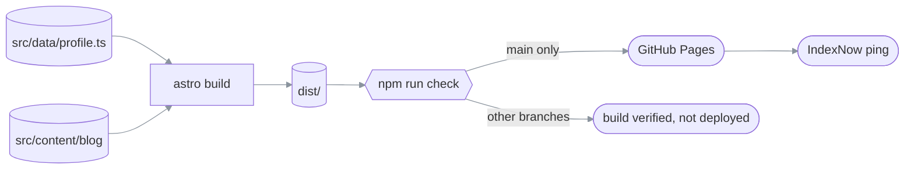
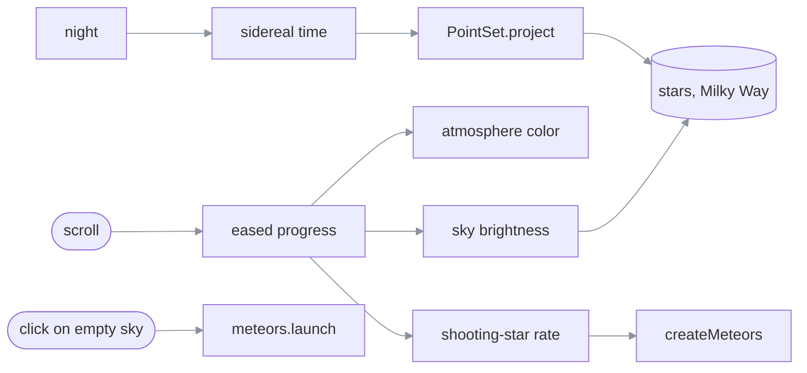

# ezzohamdan.github.io

> **What this is:** the source of Ezzaldeen Hamdan's personal site, served at
> <https://ezzohamdan.github.io/> (English) and <https://ezzohamdan.github.io/ar/> (Arabic).
> **How to read it:** cheat sheet → §1 build and deploy flow → §2 code map → §3 how the sky works →
> §4 change recipes → §5 failure messages → §6 sharp edges → §7 decisions.
> **Reflects code as of 2026-10-12** (`sky-over-amman` branch: the "sky over Amman" design).

**What must not break:**

- **One source of truth:** every fact lives in `src/data/profile.ts`. Pages, JSON-LD, `llms.txt`,
  `llms-full.txt` and the sitemap are generated from it. Never hand-edit a fact into a component.
- **Each language stands alone:** English pages show no Arabic text, and Arabic pages never show
  the English name. `npm run check` fails the build if either rule breaks.
- **Drafts never ship:** a post with `draft: true` is never built for production.

## Cheat sheet

| Task | Command |
| --- | --- |
| Install (Node ≥ 22.12) | `npm ci` |
| Develop with live reload (drafts visible) | `npm run dev` → <http://localhost:4321> |
| Production build to `dist/` | `npm run build` |
| Check the build (links, JSON-LD, hreflang, language rule, drafts) | `npm run check` |
| Preview the production build | `npm run preview`, then stop it with `npx astro preview stop` |

**Limits:**

- **JavaScript:** about 5.5 KB gzipped on first load. The sky worker, including the 1,627-star
  catalog and the planet ephemeris, is about 20 KB gzipped and loads after the page has painted.
  Everything else is HTML and CSS.
- **Fonts:** fetched from Fontsource at build time, so a build needs network access.
- **Hosting:** GitHub Pages serves static files only; there is no server code anywhere.

## 1. Build and deploy flow

```text
src/data/profile.ts ──┐
src/content/blog/*.md ┤  npm run build   ┌─ index.html, ar/index.html, 404.html
src/components, pages ┼────(astro)──────►│  robots.txt, sitemap.xml, llms.txt, llms-full.txt
public/ (CV, og, ...) ┘                  └─ _astro/ (css, ~5 KB js, fonts, webp logos)
                                                     │
                                          npm run check (fails on any violation)
                                                     │
   push to any branch ──► GitHub Actions: build + check ──► main only: deploy to Pages
                                                                      └─► ping IndexNow
```

#### 1. (rendered)



Read it as: the only way onto the live site is a push to `main` whose build passes the check;
nothing deploys from a feature branch.

> **Required:** the repo's Pages source is set to **GitHub Actions**
> (Settings → Pages → Build and deployment).
> **Prohibited:** committing `dist/`, and editing generated files such as `sitemap.xml` by hand.
> **Async:** the IndexNow ping runs after the deploy; if it fails, the deploy still stands.

## 2. Code map

| What | Source |
| --- | --- |
| All content, both languages | [`src/data/profile.ts`](src/data/profile.ts) |
| UI strings, month names, date formats | [`src/lib/i18n.ts`](src/lib/i18n.ts) |
| JSON-LD graph (`Person`, `ProfilePage`, `SoftwareSourceCode`, `BlogPosting`) | [`src/lib/schema.ts`](src/lib/schema.ts) |
| `llms.txt` / `llms-full.txt` text | [`src/lib/llms.ts`](src/lib/llms.ts) |
| Profile page (used by both languages) | [`src/components/ProfilePage.astro`](src/components/ProfilePage.astro) |
| `<head>`: meta, Open Graph, hreflang, fonts | [`src/layouts/Base.astro`](src/layouts/Base.astro) |
| Sky: page side (scroll, hero caption, star names) | [`src/components/Sky.astro`](src/components/Sky.astro) |
| Sky: atmosphere colors, drawing, twinkle, scroll dimming, shooting-star rate, wishes | [`src/scripts/sky/renderer.ts`](src/scripts/sky/renderer.ts) (runs in [`worker.ts`](src/scripts/sky/worker.ts)) |
| Sky: Amman, sidereal time, Sun, planets, galactic plane, the moment shown | [`src/scripts/sky/astro.ts`](src/scripts/sky/astro.ts) |
| Sky: catalog arrays and the projection | [`src/scripts/sky/catalog.ts`](src/scripts/sky/catalog.ts) |
| Sky: shooting stars (one shared direction, tapered trails) | [`src/scripts/sky/meteors.ts`](src/scripts/sky/meteors.ts) |
| Sky: Milky Way | [`src/scripts/sky/milky-way.ts`](src/scripts/sky/milky-way.ts) |
| Star, planet and shower names (both languages) | [`src/data/sky-names.ts`](src/data/sky-names.ts) |
| Star catalog (generated, do not edit) | [`src/data/sky.json`](src/data/sky.json) ← [`scripts/make-sky-catalog.mjs`](scripts/make-sky-catalog.mjs) |
| Amman skyline at the footer dawn | [`src/components/Skyline.astro`](src/components/Skyline.astro) |
| House of Wisdom diagram | [`src/components/Council.astro`](src/components/Council.astro) |
| Blog schema and routes | [`src/content.config.ts`](src/content.config.ts), [`src/pages/blog/`](src/pages/blog/) |
| Post-build checks | [`scripts/check-dist.mjs`](scripts/check-dist.mjs) |
| CI and deploy | [`.github/workflows/deploy.yml`](.github/workflows/deploy.yml) |

## 3. How the sky works

The background is the real, still sky over Amman: stars to magnitude 5, the naked-eye planets
and the Milky Way, positioned for right now (or 21:00 tonight if it is daytime in Amman) and
refreshed every minute. Stars twinkle; planets shine steadily, as they do in the real sky.
**Scrolling never moves anything in the sky.** It only changes the atmosphere color, how bright
the sky is, and how many shooting stars fall. Clicking empty sky makes a wish: a shooting star
launches from that point.

```text
night() ──► moment (now, or 21:00 tonight) ──► sidereal time ──► PointSet.project ──► stars, Milky Way
                                                                                 (still; re-projected each minute)
scroll position 0..1 ──(Sky.astro)──► worker: eased progress ──► atmosphere color (dusk → midnight → dawn)
                                                             ├─► sky brightness  (dims behind reading, fades at dawn)
                                                             └─► shooting-star rate (rare at top → many at the end)
click on empty sky ────(Sky.astro)──► worker: meteors.launch(x, y)
```

#### 3. (rendered)



Read it as: scroll feeds only color, brightness and the shooting-star rate. No arrow runs from
scroll to star or planet positions, and that is deliberate (see §7).

> **Guaranteed:** star positions depend only on the clock, never on scroll.
> **Reduced motion:** a still sky with no twinkle, no shooting stars and no wishes. The atmosphere
> color still follows scroll, since it is color, not motion.
> **Calm** (article pages, `<Base calmSky>`): a fixed midnight color, half brightness, rare
> shooting stars and no wishes.

| Where you are | What the sky does |
| --- | --- |
| Top of the page | Dusk: a violet afterglow low on the screen; full brightness; a shooting star every few seconds |
| Reading sections | Deep midnight, about 30% dimmer behind text |
| Approaching the end | Pre-dawn violet; shooting stars build, plus a bolide every few seconds past 70% |
| Bottom (contact) | Rose-amber dawn; stars fade while shooting stars fall over the Amman skyline |

**Tunables** (`src/scripts/sky/renderer.ts` unless noted): the atmosphere colors are the
`ATMOSPHERE` table; brightness is the `dim` line in `render`; the shooting-star rate is the `rate` line (`0.25 + 9 * smooth(0.5, 0.97, p) ** 1.5`);
the shared direction is `DX`/`DY` in `meteors.ts`.

## 4. Change recipes

**Update a fact (role, date, project, number):**

1. Edit it in `src/data/profile.ts`, in **both** `en` and `ar`.
2. Bump `site.updated`. It feeds the sitemap `lastmod`, the JSON-LD `dateModified` and the footer.
3. Verify with `npm run build && npm run check`.

**Add a project:** append to `projects` in `profile.ts`, with a `repo` if it has one; the JSON-LD
picks it up automatically. Set `featured: true` on at most one project, since it takes the
full-width card.

**Publish a blog post:**

1. Add `src/content/blog/<slug>.md` with `title`, `description`, `date`, `tags` and
   `draft: true`.
2. Preview it with `npm run dev` at `/blog/<slug>/`.
3. Flip it to `draft: false` to publish. `/blog/` and the sitemap entry appear automatically with
   the first published post.

**Change the sky:** see the tunables in §3. Then check, in this order:
1. Reduced motion (macOS: System Settings → Accessibility → Display → Reduce motion): a still
   sky with no shooting stars.
2. An article page in `npm run dev`: a dimmer sky.
3. A scroll from top to bottom: text stays easy to read, and shooting stars build at the end.

**Add a named star:** add `{ en, origin, ar }` to `starNames` in `src/data/sky-names.ts`, where
`en` is the catalog's proper name. Regenerate the catalog with the commands at the top of
`scripts/make-sky-catalog.mjs`. The script exits with `named star not found in catalog: <name>`
if the spelling differs (it's "Shedar", not "Schedar").

## 5. Failure messages from `npm run check`

| Message | Meaning | Fix |
| --- | --- | --- |
| `Arabic text on an English page: "…"` | An English page shows Arabic text, including in `alt`, `title` or `aria-label` | Move the string into the `en` side of `profile.ts` or `i18n.ts` |
| `English name on an Arabic page` | "Ezzaldeen" or "Hamdan" is visible on an Arabic page | Use `person.name.ar` |
| `broken link /x/` | An internal `href`/`src` has no file in `dist/` | Fix the path, or add the file to `public/` |
| `invalid JSON-LD` | A `<script type="application/ld+json">` doesn't parse | Check `src/lib/schema.ts` |
| `hreflang: A does not link back to B` | Language alternates aren't reciprocal | Pass the same `alternates` on both pages |
| `draft "x.md" was built into dist/blog` | The draft filter in `src/lib/blog.ts` broke | Restore `import.meta.env.DEV \|\| !data.draft` |
| `expected exactly one <h1>` | A page has zero or several `<h1>` | One per page; sections use `<h2>` |

## 6. Sharp edges

- ⚠ **Scroll-driven CSS is written in longhand on purpose** (`global.css`, "Scroll-driven
  motion"). The CSS minifier folds `animation-timeline` into the `animation` shorthand, browsers
  reject that, and the whole rule silently disappears. Don't "tidy" it back into a shorthand.
- ⚠ **`public/portfolio/index.html` is a redirect stub,** not dead code. The old URL
  `/portfolio/` is still printed in the CV and on other profiles.
- **`public/a89a…f4.txt` is the IndexNow key.** It's public by design; the protocol verifies site
  ownership by fetching it.
- **Everything is crawlable** (`src/pages/robots.txt.ts`), AI crawlers included. That's
  deliberate for a personal site.
- **The sky runs in a Web Worker** via `OffscreenCanvas`. Browsers without it fall back to the same
  renderer on the main thread, which is why `sky/renderer.ts` is imported in two places.
- ⚠ **`src/data/sky.json` is generated.** Hand edits are lost the next time
  `scripts/make-sky-catalog.mjs` runs. It is BSD-3-Clause data (see Credits).
- ⚠ **Planet positions are valid from 1800 to 2050.** They use Standish's approximate Keplerian
  elements (table 1, `astro.ts::ELEMENTS`). After 2050, switch to table 2 (valid 3000 BC to
  3000 AD), which adds correction terms for Jupiter and Saturn.
- **"Empty sky" means "not over actual text"** (`Sky.astro::onSky`). Text blocks are tested
  against their real line boxes, so the space beside a heading counts as sky. Without that, the
  empty-looking area right of the name didn't launch wishes.
- **Jordan has no daylight saving time** (UTC+3 all year since 2022), so `sky/astro.ts` uses a
  fixed offset. If that ever changes, the caption and the 21:00 "tonight" sky drift by an hour.
- **Unlike what you'd expect, east is on the left** of the sky. The projection shows the sky as you
  see it lying on your back with north at the top, the way an astrolabe plate does.
- **Star labels only appear over empty sky** (`Sky.astro`, the `content` selector), so hovering
  text never pops a label in the middle of reading.

## 7. Decisions

- **Astro, not hand-written HTML.** GitHub Pages only *serves* static files; it doesn't care how
  they were made. The built `dist/` is plain HTML, CSS and a little JS. Astro gives one data file
  for two languages, image and font optimization, and drafts that are actually unpublished.
  Hand-written pages would have to keep English, Arabic, JSON-LD and `llms.txt` in sync by hand,
  which is how the old Project-9 site ended up contradicting this one.
- **Strictly monolingual pages** (owner's choice). The two languages are linked only through
  `hreflang` and the shared JSON-LD `@id` (`https://ezzohamdan.github.io/#person`), never in
  visible text.
- **No photo** anywhere on the site (owner's choice). Social previews use the typographic cards in
  `public/og/`.
- **Root user site.** The repo was renamed from `portfolio` to `EzzoHamdan.github.io`, because
  `robots.txt`, the sitemap and `llms.txt` only work at the domain root. A custom domain is
  `[planned]` and needs no code change beyond `site.url` and a `public/CNAME` file.
- **"Sky over Amman" redesign:** this branch. The neon design is preserved on `astro-rebuild` as
  the fallback.
- **The sky is real, not decorative noise:** positions come from sidereal time at Amman, so a
  visitor at 21:00 sees roughly what is overhead in Amman at 21:00. Verified on 2026-10-12 at
  20:19: Polaris at 32.1° altitude (equal to Amman's latitude) and Vega at 58° in the WNW.
- **No AI-generated video or imagery.** The sky is procedural and the skyline is generated at
  build time; both are lighter than a video and specific to Amman.
- **Shooting stars share exactly one direction** (down-left at 45°, no per-meteor tilt) and are
  placed by the middle of their visible path, so they spread evenly across the width. The first
  version spawned only along the top and right edges, which bunched them on the right. A ±6° tilt
  was tried and dropped: the owner wants one unified path.
- **Shooting-star look:** tapered two-tone trails, glowing heads, flares and lingering trains (the
  owner preferred this over the original two-ring style).
- `[historical]` **Tried and dropped on 2026-10-12, do not re-propose without a new reason:**
  - Rotating the sky with scroll, with long-exposure star trails (eased, then accumulating).
    Dropped: any motion of the star field behind text made reading hard and strained the eyes.
  - Constellation figures that drew themselves in, with names. Dropped: too literal; the brief
    meant "stars", not constellations.
  - Shooting stars radiating from the apex of Earth's motion. Astronomically right, but they
    looked like they came from nowhere in every direction. The single-direction look won.

## Credits

Star positions and star names come from
[d3-celestial](https://github.com/ofrohn/d3-celestial) (© 2015 Olaf Frohn, BSD-3-Clause), which
is built on Hipparcos and Yale Bright Star Catalog data. Brand icons are from
[Simple Icons](https://simpleicons.org/) (CC0).
