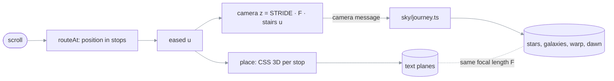

# ezzohamdan.github.io

> **What this is:** the source of Ezzaldeen Hamdan's personal site, served at
> <https://ezzohamdan.github.io/> (English) and <https://ezzohamdan.github.io/ar/> (Arabic).
> **How to read it:** cheat sheet → §1 build and deploy flow → §2 code map → §3 how the sky works →
> §4 change recipes → §5 failure messages → §6 sharp edges → §7 decisions.
> **Reflects code as of 2026-10-12** (`galaxy-journey` branch: the galaxy journey, an experiment
> built on the "sky over Amman" design, which stays on `sky-over-amman`).

**What must not break:**

- **One source of truth:** every fact lives in `src/data/profile.ts`. Pages, JSON-LD, `llms.txt`,
  `llms-full.txt` and the sitemap are generated from it. Never hand-edit a fact into a component.
- **Each language stands alone:** English pages show no Arabic text, and Arabic pages never show
  the English name. `npm run check` fails the build if either rule breaks.
- **Drafts never ship:** a post with `draft: true` is never built for production.

## Cheat sheet

| Task | Command |
| --- | --- |
| Install (Node ≥ 22.12) | `npm ci` |
| Develop with live reload (drafts visible) | `npm run dev` → <http://localhost:4321> |
| Production build to `dist/` | `npm run build` |
| Check the build (links, JSON-LD, hreflang, language rule, drafts) | `npm run check` |
| Preview the production build | `npm run preview`, then stop it with `npx astro preview stop` |

**Limits:**

- **JavaScript:** about 10 KB gzipped on first load (the sky's page side and the journey
  choreography). The sky worker, including the 5,044-star catalog (every naked-eye star, to
  magnitude 6), the planet ephemeris, the land map and both renderers, is about 58 KB gzipped and
  loads after the page has painted. Everything else is HTML and CSS.
- **The galaxy journey** needs a window at least 900 × 560 px with motion allowed
  (`journey.ts::JOURNEY_QUERY`); everything else gets the dome.
- **Fonts:** fetched from Fontsource at build time, so a build needs network access.
- **Hosting:** GitHub Pages serves static files only; there is no server code anywhere.

## 1. Build and deploy flow

```text
src/data/profile.ts ──┐
src/content/blog/*.md ┤  npm run build   ┌─ index.html, ar/index.html, 404.html
src/components, pages ┼────(astro)──────►│  robots.txt, sitemap.xml, llms.txt, llms-full.txt
public/ (CV, og, ...) ┘                  └─ _astro/ (css, ~5 KB js, fonts, webp logos)
                                                     │
                                          npm run check (fails on any violation)
                                                     │
   push to any branch ──► GitHub Actions: build + check ──► main only: deploy to Pages
                                                                      └─► ping IndexNow
```

#### 1. (rendered)


Read it as: the only way onto the live site is a push to `main` whose build passes the check;
nothing deploys from a feature branch.

> **Required:** the repo's Pages source is set to **GitHub Actions**
> (Settings → Pages → Build and deployment).
> **Prohibited:** committing `dist/`, and editing generated files such as `sitemap.xml` by hand.
> **Async:** the IndexNow ping runs after the deploy; if it fails, the deploy still stands.

## 2. Code map

| What | Source |
| --- | --- |
| All content, both languages | [`src/data/profile.ts`](src/data/profile.ts) |
| UI strings, month names, date formats | [`src/lib/i18n.ts`](src/lib/i18n.ts) |
| JSON-LD graph (`Person`, `ProfilePage`, `SoftwareSourceCode`, `BlogPosting`) | [`src/lib/schema.ts`](src/lib/schema.ts) |
| `llms.txt` / `llms-full.txt` text | [`src/lib/llms.ts`](src/lib/llms.ts) |
| Profile page (used by both languages) | [`src/components/ProfilePage.astro`](src/components/ProfilePage.astro) |
| `<head>`: meta, Open Graph, hreflang, fonts | [`src/layouts/Base.astro`](src/layouts/Base.astro) |
| Sky: page side (picks the dome or the journey, scroll, section anchors, captions, star names, wishes) | [`src/components/Sky.astro`](src/components/Sky.astro) |
| Sky, the dome: atmosphere colors, drawing, twinkle, scroll dimming, shooting-star rate, wishes | [`src/scripts/sky/renderer.ts`](src/scripts/sky/renderer.ts) (runs in [`worker.ts`](src/scripts/sky/worker.ts)) |
| Galaxy journey, page side: stops, scroll track, plane choreography, the camera, nav and focus | [`src/scripts/journey.ts`](src/scripts/journey.ts) |
| Galaxy journey, sky side: star field, galaxies, warp, takeoff and landing | [`src/scripts/sky/journey.ts`](src/scripts/sky/journey.ts) (same worker) |
| Galaxy portraits (Andromeda, Triangulum, Whirlpool, Sombrero, Milky Way) and the Sun's place in the Milky Way | [`src/scripts/sky/galaxies.ts`](src/scripts/sky/galaxies.ts) |
| The globe at the end (Amman at the next sunrise) | [`src/scripts/sky/earth.ts`](src/scripts/sky/earth.ts) |
| Land map for the globe (generated, do not edit) | [`src/data/earth.json`](src/data/earth.json) ← [`scripts/make-earth-map.mjs`](scripts/make-earth-map.mjs) |
| Sky: Amman, sidereal time, Sun, planets, galactic plane, the moment shown | [`src/scripts/sky/astro.ts`](src/scripts/sky/astro.ts) |
| Sky: catalog arrays, the camera and its lens, the projection | [`src/scripts/sky/catalog.ts`](src/scripts/sky/catalog.ts) |
| Sky: shooting stars (one shared direction, tapered trails) | [`src/scripts/sky/meteors.ts`](src/scripts/sky/meteors.ts) |
| Sky: Milky Way | [`src/scripts/sky/milky-way.ts`](src/scripts/sky/milky-way.ts) |
| Star, planet and shower names (both languages) | [`src/data/sky-names.ts`](src/data/sky-names.ts) |
| Star catalog (generated, do not edit) | [`src/data/sky.json`](src/data/sky.json) ← [`scripts/make-sky-catalog.mjs`](scripts/make-sky-catalog.mjs) |
| Amman at first light (Temple of Hercules, King Abdullah I Mosque, the Abdali towers, the Roman Theatre, stone houses with their rooftops and balconies, minarets, beacons, pigeons, window lights) | [`src/components/Skyline.astro`](src/components/Skyline.astro) |
| House of Wisdom diagram | [`src/components/Council.astro`](src/components/Council.astro) |
| Blog schema and routes | [`src/content.config.ts`](src/content.config.ts), [`src/pages/blog/`](src/pages/blog/) |
| Post-build checks | [`scripts/check-dist.mjs`](scripts/check-dist.mjs) |
| CI and deploy | [`.github/workflows/deploy.yml`](.github/workflows/deploy.yml) |

## 3. How the sky works

The sky has two modes, chosen once per page load:

| Mode | Where | Section |
| --- | --- | --- |
| **The galaxy journey:** scrolling flies forward through space, past real galaxies, with the content on planes along the route | Profile pages on windows at least 900 × 560 px with motion allowed | §3b |
| **The dome:** the real sky over Amman, turning with scroll | Phones, short windows, reduced motion, article pages | §3a |

The inline script in `Base.astro` sets `html.journey` before first paint when the profile page
qualifies; `Sky.astro` reads that class and tells the worker which renderer to build.

### 3a. The dome

The page is a journey through the real sky over Amman, seen as a dome. The sky holds every
naked-eye star (to magnitude 6), the naked-eye planets and the Milky Way, positioned for right now (or 21:00 tonight
if it is daytime in Amman). Stars twinkle; planets shine steadily, as in the real sky. Scrolling
moves two things:

- **Time:** the whole page spans six hours of sky rotation around Polaris (90°).
- **The camera:** each section is a *shot*, each zoomed a little deeper than the last. The camera
  holds while you read a section and glides to the next shot as the next section begins, with a
  gentle push-in. Every move takes the same scroll distance (about one screen), so no move is
  faster than another. Like a telescope, zooming in reveals fainter stars (one magnitude per
  doubling of magnification).

Everything is eased, and nothing ever leaves trails. Scroll also sets the atmosphere color, the
sky's brightness and the shooting-star rate. Clicking empty sky makes a wish.

| Section | Shot (`renderer.ts::SHOTS`) | Caption |
| --- | --- | --- |
| `hero` | Straight up, the whole dome (lens 1, stereographic) | The hero caption: "The sky over Amman right now, 21:18" |
| `about` | Tilted toward the south | Overhead or south: the nearest named star |
| `experience` | The southern sky | "Looking south: …" |
| `projects` | East, where new stars rise | The brightest planet in view, if any |
| `education` | North, toward Polaris | "Looking north: Polaris" |
| `contact` | Down to the eastern horizon at dawn (lens 0.12, near-rectilinear). The horizon follows the skyline's live position, so the camera lowers its gaze as the city rises into view | "Looking east, toward dawn over Amman" |

```text
Sky.astro ── scroll 0..1 + skyline's horizon y now ─► worker: eased progress (time constant ≈ 0.22 s)
          └─ "scenes": where each section starts (px)  │
                                            ├─► time = now + progress × 6 h ──► sidereal time ─┐
                                            ├─► shot = SHOTS[section], gliding between ─► camera()┤
                                            │                                                     ▼
                                            │              PointSet.project: stars, planets, Milky Way
                                            ├─► atmosphere color · sky brightness · shooting-star rate
worker ── "view" (what is in the center), "hover" (star or planet name) ──► captions on the page
click on empty sky ─► worker: meteors.launch(x, y)
```

#### 3a. (rendered)


Read it as: scroll moves the sky only through time and the camera. The dome turns, and the
camera looks somewhere new for each section. No text is ever drawn on the canvas; every caption
is DOM text in `Sky.astro`.

> **Guaranteed:** no trails are ever drawn. In reading shots no ground shows (`resolve` tilts the
> camera up until the whole horizon is off screen); only the contact shot shows the horizon.
> **Prohibited:** long-exposure trails or anything else that accumulates behind text (§7).
> **Reduced motion:** a still overhead sky (no rotation, camera moves, twinkle, shooting stars or
> wishes). The atmosphere color still follows scroll, since it is color, not motion.
> **Calm** (article pages, `<Base calmSky>`): a still overhead sky in a fixed midnight color, half
> brightness, rare shooting stars and no wishes.

**Text on the dome:** content blocks curve away and fade at the top and bottom of the screen and
are flat through the middle, where they are read (`global.css`, `dome-curve`, CSS scroll-driven,
written in longhand like the other scroll-driven rules).

**Tunables** (`src/scripts/sky/renderer.ts` unless noted): shots are the `SHOTS` table; the
atmosphere colors are the `ATMOSPHERE` table; brightness is the `dim` line in `render`; the
rotation span is `DOME_SPAN` and its glide is the `4.5` in the progress easing; the shooting-star
rate is the `rate` line (`0.25 + 2.2 * smooth(0.5, 0.97, p) ** 1.5`); meteor lifetime and speed
are in `meteors.ts::spawn`, and the shared direction is `DX`/`DY`.

### 3b. The galaxy journey

Scrolling flies a camera straight ahead through space. It only ever moves forward: no pans, no
rolls, no zoom. That is the point of this mode. In the dome, a fast scroll swung the camera between
five directions and zoom levels, which read as disorganized; here a fast scroll is just faster
flight.

Every `[data-stop]` element in `ProfilePage.astro` is a **stop**: the hero, each section title
(`data-stop="title"`) and each block of content (`data-stop="panel"`). Stops are fixed to the
screen and moved with CSS 3D transforms; the sections stay in the document only as the scroll
track, so anchors, the header highlight, search engines and screen readers see the normal page.
Every stop does the same three things:

| Phase | Plane | Camera |
| --- | --- | --- |
| **Arrive** (from 4 focal lengths away) | A content stop's parts are fixed in space beside the route (below); perspective alone grows them and carries them outward to their sides, and cards "render" in from top to bottom. Titles come straight down the middle and assemble from points of starlight. | Glides forward one `STRIDE` |
| **Hold** (±`HOLD` = 0.2 stop) | Still: the card on the stop's side, turned 10° toward the route, the visuals on the other side. Nothing else is visible. Titles are flat and centered. | Almost still (`CREEP`; the text ignores it) |
| **Depart** | The parts pass out of view on their sides, nearest first, as the camera goes on. Titles rise overhead; the hero sinks away below and tilts like the ground at takeoff, over a longer first leg (`WEIGHT.hero`) | Moves on |

The galaxies come **farthest first**, so the whole flight is a return to Earth (owner's request):

| Section | Passes (`sky/journey.ts::DESTINATIONS`) | From Earth (`journey.ts::DISTANCE`) | Space tinted |
| --- | --- | --- | --- |
| `hero` | Takeoff: the real sky over Amman straight up; the stars stream past as the atmosphere falls away, and stop twinkling | (Amman) | Night over Amman |
| `about` | The Sombrero, its dust lane edge-on | 31 million light-years | Amber |
| `experience` | The Whirlpool and its companion NGC 5195 | 28 million | Magenta |
| `projects` | The Triangulum galaxy | 2.7 million | Teal |
| `education` | Andromeda, al-Sufi's "little cloud", with M32 and M110 | 2.5 million | Violet |
| *(after the last stop)* | The homecoming, below | 100,000 light-years, 4 light-hours, 22,000 km | Space, then dawn |
| `contact` | Dawn over Amman with shooting stars, some falling behind the skyline, as in the dome | (home) | Dawn |

Each galaxy is far behind its section's title, grows as the section is read, and is passed close
by on the way to the next title. The caption at the bottom names it and gives the distance from
Earth, which counts down on a log scale between places (`journey.ts::distanceAt`, units from
millions of light-years down to km in `formatDistance`) and holds still while a stop is read.

**Stops as places in space** (`journey.ts::placeParts`, owner's request). A content stop is a
see-through frame whose `[data-part]`s are fixed at points beside the route, given in
`ProfilePage.astro` as `data-at="x,y,depth"` (x in viewport widths toward the stop's side, y in
viewport heights, extra depth in focal lengths). The card goes on the stop's side; visuals go on
the other side, farther away, so they move with real parallax: each organization's logo on a
planet in its brand color (`BRAND`) ringed by a full orbit, the House of Wisdom diagram, the
certificates, and four "In short" facts floating on their own (the other facts are hidden in the
journey but stay in the page). Roles show two highlights per group until "Show all highlights"
(`.more`). The mouse leans the camera a little (`lean` message), so near parts shift more than
far ones and the sky leans the same way. Cards lift a little on hover. Only visuals bob; text
never moves on its own.

**Space never freezes.** While a stop holds, the camera keeps a slow drift (`sky/journey.ts`, `dz`,
`dx`, `dy`, `breath`): near stars shift more than far ones and galaxies swell slightly. In the
homecoming the planets start where they really are and then orbit (Mercury about every 24 s), and
the marked places ripple. The hero's real sky and the dawn don't drift; they twinkle instead.

**The homecoming** (`sky/journey.ts::drawHomeBack`, `drawHomeFront`). After the last stop come
three more stops with no text (`journey.ts::HOME_STAGES`), each holding like any stop. The camera
slows to a creep and the motion becomes a powers-of-ten zoom (`ZOOM` = 14× per stage), always
closing in on the next destination at the center of the screen:

| Stage | What is on screen |
| --- | --- |
| `milkyway` | The Milky Way, centered on the Sun's place in the Orion Arm (`galaxies.ts::SUN_IN_MILKY_WAY`), marked with a brass ring |
| `sun` | The Solar System, the planets where they really are at the next sunrise in Amman (`astro.ts::solarSystem`), orbits on a square-root scale so the inner planets aren't crowded into the Sun |
| `earth` | The zoom moves from the Sun to Earth, which grows out of its dot into a globe centered on Amman, lit for the moment of the next sunrise (`astro.ts::nextSunrise`, `subsolarPoint`), so Amman sits on the dawn line, marked in brass |
| landing | The globe grows a little and fades into the predawn sky as the contact section and the skyline scroll in |

The Solar System is turned so the Sun lies on the same side of Earth as the daylight on the globe.

```text
scroll ─► journey.ts: routeAt(scrollY) = position in stops (u)
            │  eased (LAG 0.14 s)
            ├─► place(stop, arrive, depart): CSS perspective(F) transform, opacity, --r, --a
            │       (F = 0.72 × viewport width, the same focal length the stars use)
            └─► "camera" message per frame: z = STRIDE·F·stairs(u), speed, u, landing, skyline y
                     ▼
worker: sky/journey.ts ─► background (night → space → dawn) · tint per section
                       ─► galaxies (sprites painted once, galaxies.ts) · star field (real + generated,
                          recycled) · warp streaks only when fast · shooting stars (hero, dawn)
```

#### 3b. (rendered)



Read it as: one eased number drives both the text planes and the stars, through one focal
length, so text and space move as one. Nothing on the canvas depends on where the text is.

> **Guaranteed:** while a stop holds, its parts are still (unless the mouse leans the camera) and
> no other stop is visible. Cards are turned 10° toward the route and have no mask once the stop
> holds; a part too tall for the screen is pushed back until it fits. Warp streaks
> fade in only above 6 focal lengths of travel a second (the `warp` line), so an unhurried move
> between stops barely streaks and nothing streaks while a stop holds.
> **Prohibited:** camera pans, rolls or zooms between sections (the reason this mode exists), and
> anything that accumulates behind text (§7).
> **Focus and links:** a link (the header, the name) or keyboard focus aimed at a stop more than
> one away makes a single **jump** (`journey.ts::flyTo`): the plane being read leaves, the camera
> crosses the distance in one smooth move (`glide`, 1.1 to 2.4 s) with every plane in between
> hidden and the galaxies dimmed, and only the destination arrives. The page scrolls along, so the
> header highlight and the address stay right; any wheel, touch or key press takes over. A
> neighbouring stop is an ordinary smooth scroll. A reload returns to the same place.

**Tunables** (`src/scripts/journey.ts` unless noted): `HOLD` (hold width), `STRIDE` (camera travel
and arrival distance per stop), `PACE` (scroll per stop) and `WEIGHT` (its share per kind of
stop), `HOME_WEIGHT` (scroll per homecoming stage), `LAG` (camera easing), `CREEP`; the arrive and
depart paths are in `place`, a jump's duration is the `ms` line in `flyTo`, and the places'
distances are `DISTANCE`. The parallax depths are the `--depth` and `calc(var(--px) * …)` values in
`global.css` (the galaxy journey block). The idle drift's amplitudes are the `dz`, `dx`, `dy` lines
in `sky/journey.ts::render`. The homecoming's
zoom is `homeLevel`, `ZOOM` and `ECLIPTIC_TILT` in `sky/journey.ts`; the globe's colors are at the
top of `sky/earth.ts`. In `src/scripts/sky/journey.ts`:
`DESTINATIONS` (galaxy, side, tint), the galaxy offsets in `placeGalaxies`, warp is `EXPOSURE`,
`MAX_STREAK` and the `warp` line, and the sky colors are `NIGHT`, `SPACE`, `PREDAWN`, `DAWN`. Each
galaxy's look is its branch in `galaxies.ts::paintGalaxy`.

## 4. Change recipes

**Update a fact (role, date, project, number):**

1. Edit it in `src/data/profile.ts`, in **both** `en` and `ar`.
2. Bump `site.updated`. It feeds the sitemap `lastmod`, the JSON-LD `dateModified` and the footer.
3. Verify with `npm run build && npm run check`.

**Add a project:** append to `projects` in `profile.ts`, with a `repo` if it has one; the JSON-LD
picks it up automatically. Set `featured: true` on at most one project, since it takes the
full-width card.

**Publish a blog post:**

1. Add `src/content/blog/<slug>.md` with `title`, `description`, `date`, `tags` and
   `draft: true`.
2. Preview it with `npm run dev` at `/blog/<slug>/`.
3. Flip it to `draft: false` to publish. `/blog/` and the sitemap entry appear automatically with
   the first published post.

**Add a block of content to the journey:** put `data-stop="panel"` on its outermost element (or
`data-stop="title"` on a section's `<h2>`), inside a `<section id>` in `main`. Keep it under one
screen tall at 1440 × 800; a taller plane is pushed back until it fits, which shrinks its text. A
section with stops but no entry in `sky/journey.ts::DESTINATIONS` simply has no galaxy. Verify by
scrolling to it in `npm run dev` on a wide window: it should hold flat and centered, with nothing
else on screen.

**Change the sky:** see the tunables in §3a and §3b. Then check, in this order:
1. Reduced motion (macOS: System Settings → Accessibility → Display → Reduce motion): a still
   sky with no shooting stars.
2. An article page in `npm run dev`: a dimmer sky.
3. A scroll from top to bottom: text stays easy to read, and shooting stars build at the end.
4. A narrow window (under 900 px) for the dome, and a wide one for the journey, including a fast
   flick across several stops: planes dim, stars streak briefly, and the stop you land on is crisp.

**Add a named star:** add `{ en, origin, ar }` to `starNames` in `src/data/sky-names.ts`, where
`en` is the catalog's proper name. Regenerate the catalog with the commands at the top of
`scripts/make-sky-catalog.mjs`. The script exits with `named star not found in catalog: <name>`
if the spelling differs (it's "Shedar", not "Schedar").

## 5. Failure messages from `npm run check`

| Message | Meaning | Fix |
| --- | --- | --- |
| `Arabic text on an English page: "…"` | An English page shows Arabic text, including in `alt`, `title` or `aria-label` | Move the string into the `en` side of `profile.ts` or `i18n.ts` |
| `English name on an Arabic page` | "Ezzaldeen" or "Hamdan" is visible on an Arabic page | Use `person.name.ar` |
| `broken link /x/` | An internal `href`/`src` has no file in `dist/` | Fix the path, or add the file to `public/` |
| `invalid JSON-LD` | A `<script type="application/ld+json">` doesn't parse | Check `src/lib/schema.ts` |
| `hreflang: A does not link back to B` | Language alternates aren't reciprocal | Pass the same `alternates` on both pages |
| `draft "x.md" was built into dist/blog` | The draft filter in `src/lib/blog.ts` broke | Restore `import.meta.env.DEV \|\| !data.draft` |
| `expected exactly one <h1>` | A page has zero or several `<h1>` | One per page; sections use `<h2>` |

## 6. Sharp edges

- ⚠ **Scroll-driven CSS is written in longhand on purpose** (`global.css`, "Scroll-driven
  motion"). The CSS minifier folds `animation-timeline` into the `animation` shorthand, browsers
  reject that, and the whole rule silently disappears. Don't "tidy" it back into a shorthand.
- ⚠ **`public/portfolio/index.html` is a redirect stub,** not dead code. The old URL
  `/portfolio/` is still printed in the CV and on other profiles.
- **`public/a89a…f4.txt` is the IndexNow key.** It's public by design; the protocol verifies site
  ownership by fetching it.
- **Everything is crawlable** (`src/pages/robots.txt.ts`), AI crawlers included. That's
  deliberate for a personal site.
- **The sky runs in a Web Worker** via `OffscreenCanvas`. Browsers without it fall back to the same
  renderer on the main thread, which is why `sky/renderer.ts` is imported in two places.
- ⚠ **`src/data/sky.json` is generated.** Hand edits are lost the next time
  `scripts/make-sky-catalog.mjs` runs. It is BSD-3-Clause data (see Credits).
- ⚠ **`fov` in `camera()` is the angle from the center of view to a screen corner,** not half of
  something. For lens 1 the focal length is exactly the old `R / tan(fov / 2)`, so the dome shots
  look identical to before the camera existed; a halved angle once zoomed every shot in about 2×.
- ⚠ **Unlike what you'd expect, the horizon curves up at the sides** in the dome projection when
  the camera tilts, so checking the point straight ahead is not enough to keep ground off screen.
  `horizonTop` samples the whole visible horizon. Drawing the ground from points sorted by x
  instead of by azimuth once striped the whole sky.
- ⚠ **The dawn shot follows the skyline live.** `Sky.astro::horizonNow` sends where the skyline's
  horizon line (`data-horizon` in its viewBox) is on screen with every scroll update, and the
  contact shot is re-solved every frame to match. Two traps: the skyline uses
  `preserveAspectRatio="xMidYMax slice"`, so map viewBox y with its real scale, never as a
  fraction of the element's height; and an earlier version solved the horizon only for the very
  bottom of the page, which left a visible band above the city everywhere else. If `.skyline` is
  renamed, the shot falls back to 75% of the screen height.
- **The skyline keeps its own proportions** (`aspect-ratio: 1440 / 420`, capped at 48vh) so wide
  screens don't crop the tallest tower or the columns. Keep landmark tops below viewBox y ≈ 70.
- ⚠ **Ugly on purpose: the skyline is merged by color, layer by layer** (`Skyline.astro`, `layer`,
  `add`). Every shape of one fill in a layer goes into a single path, so hundreds of houses cost a
  few dozen elements; window grids are SVG patterns filled into one rectangle per house, and paths
  move relatively with short numbers. The price: inside a layer, paths paint in the order their
  fill was first used, not shape by shape. So shapes that must overlap belong in separate layers
  (each row of houses is its own layer, back to front), and walls and hills go in a wall pass
  (`rect(…, true)`, `hill`) that paints before every detail; without it, a wall tone first used
  after some windows painted over them and left blank houses. Drawing each house as its own group
  made the inline SVG about 185 KB; this way it is about 130 KB (32 KB gzipped) with full detail.
- ⚠ **Planet positions are valid from 1800 to 2050.** They use Standish's approximate Keplerian
  elements (table 1, `astro.ts::ELEMENTS`). After 2050, switch to table 2 (valid 3000 BC to
  3000 AD), which adds correction terms for Jupiter and Saturn.
- **"Empty sky" means "not over actual text"** (`Sky.astro::onSky`). Text blocks are tested
  against their real line boxes, so the space beside a heading counts as sky. Without that, the
  empty-looking area right of the name didn't launch wishes.
- **Jordan has no daylight saving time** (UTC+3 all year since 2022), so `sky/astro.ts` uses a
  fixed offset. If that ever changes, the caption and the 21:00 "tonight" sky drift by an hour.
- **Unlike what you'd expect, east is on the left** of the sky. The projection shows the sky as you
  see it lying on your back with north at the top, the way an astrolabe plate does.
- **Star labels only appear over empty sky** (`Sky.astro`, the `content` selector), so hovering
  text never pops a label in the middle of reading. The journey has no star labels; its stars
  move.
- ⚠ **Journey mode is decided in two places that must agree:** the inline script in
  `Base.astro` (before first paint, so the layout never jumps) and `journey.ts::JOURNEY_QUERY`
  (which reloads the page when the window crosses it, to switch modes cleanly).
- ⚠ **Journey planes are `position: fixed`.** A `transform`, `filter`, `contain` or `will-change`
  on any ancestor of a `[data-stop]` (a section, `.container`, `.projects`, the `<ol>`) makes it
  fixed to that ancestor instead of the screen, and the plane vanishes or jumps. The sections'
  heights are set inline by `journey.ts::layout`; CSS heights on them are overridden.
- **Unlike what you'd expect, journey titles are rebuilt by script** (`journey.ts::spell`): the
  `<h2>` holds a screen-reader copy of the text plus one span per letter (per word in Arabic,
  whose letters join) for the starlight assembly. Edit the title in `i18n.ts`, never in the DOM.
- **The stars and the text share one focal length:** `F = 0.72 × viewport width`, used both as the
  CSS `perspective()` of every plane and by the star field (sent in the `route` message). Change
  it in `journey.ts::layout` only.
- ⚠ **`src/data/earth.json` is generated** from Natural Earth by `scripts/make-earth-map.mjs` (the
  commands are at its top; it can also write a PNG preview to check the coastlines). Natural Earth
  polygons wrap across the 180° meridian and Antarctica's wraps around the pole; the script
  unwraps them, and a naive fill once failed on exactly that.
- **The homecoming is lit for the next sunrise, not for now.** The globe and the planets are
  computed once when the sky starts (`sky/journey.ts`, `sunrise`), so the story always lands at
  dawn whatever the hour. The globe is painted 48 rows a frame from then on, so it never stalls
  the sky.
- ⚠ **A part's position comes from `data-at`, not from the page's layout.** In the journey every
  `[data-part]` is absolutely centered in its stop's frame and moved by a transform; margins and
  grid placement on it do nothing there. Its width is set in the galaxy journey block of
  `global.css`. A wrapper that is `display: contents` elsewhere (`.role-mark`, `.council-wrap`)
  must be given a box in the journey, or its child escapes placement and fading.
- **Title glyphs carry extra padding** (`.glyph`, `padding-block` with matching negative margins)
  because their starlit fill (`background-clip: text`) only paints inside each glyph's box;
  without it descenders such as the g in "Background" were cut off.
- **Two logos contain Arabic script** (IIAB and AAU) and show on the English page too. They are
  images, so `npm run check` (which checks text) does not flag them; the owner wanted the logos.
- **The IIAB mark sits in a wide band inside a square image,** so its moon gets `.moon.wide`
  (larger) by role id in `ProfilePage.astro`. A new logo with lots of padding needs the same.
- **Hidden highlights are still in the page.** `.extra` bullets are only hidden by CSS in the
  journey, so search engines, `llms-full.txt` readers and the dome see every one.
- **The project pairs** (`.project-pair`) exist only for the journey, where each pair is one
  stop; elsewhere they are `display: contents`, so the projects grid is unchanged.

## 7. Decisions

- **Astro, not hand-written HTML.** GitHub Pages only *serves* static files; it doesn't care how
  they were made. The built `dist/` is plain HTML, CSS and a little JS. Astro gives one data file
  for two languages, image and font optimization, and drafts that are actually unpublished.
  Hand-written pages would have to keep English, Arabic, JSON-LD and `llms.txt` in sync by hand,
  which is how the old Project-9 site ended up contradicting this one.
- **Strictly monolingual pages** (owner's choice). The two languages are linked only through
  `hreflang` and the shared JSON-LD `@id` (`https://ezzohamdan.github.io/#person`), never in
  visible text.
- **No photo** anywhere on the site (owner's choice). Social previews use the typographic cards in
  `public/og/`.
- **Root user site.** The repo was renamed from `portfolio` to `EzzoHamdan.github.io`, because
  `robots.txt`, the sitemap and `llms.txt` only work at the domain root. A custom domain is
  `[planned]` and needs no code change beyond `site.url` and a `public/CNAME` file.
- **"Sky over Amman" redesign:** on `sky-over-amman`. The neon design is preserved on
  `astro-rebuild` as the fallback.
- **The galaxy journey** (this branch, an experiment). The owner asked for a scroll that travels
  through space with tilted text that is part of the journey, after finding the dome's zooming and
  tilting between sections disorganized on fast scrolls. The camera only moves forward, every stop
  follows the same arrive, hold, depart path, and only one plane shows while reading. The dome
  stays for phones and reduced motion, where 3D planes would be cramped or unwelcome.
- **The homecoming** (2026-10-12, owner's request): from far away to the Milky Way, the Solar
  System, Earth and then Amman. It is a zoom rather than more forward flight, because each stage
  is a hundred to a billion times smaller than the last; flying at one speed would rush or stall
  them. The orbits are not to scale (square root of the distance) and the Earth grows faster than
  its orbit, both on purpose: at true scale the inner planets and Earth would be invisible.
- **Links jump instead of scrolling through** (2026-10-12, owner's report). Smooth-scrolling to
  a far section played every plane's arrive and depart on the way, which flashed them past
  abruptly. A jump is one move with nothing in between (§3b).
- **Farthest galaxy first** (2026-10-12, owner's request): the first order (Andromeda outward to
  the Sombrero) read as flying away from home. Distances from McQuinn et al. 2016 for the Sombrero
  (31 million light-years) and the Whirlpool (28 million).
- **Amman lit, not in silhouette** (2026-10-13, owner's request with photographs): the dark
  skyline read as "wacky". The city is now limestone lit gold by the first sun from the east,
  with its real landmarks drawn from the photos, under a sky that still holds the night. The
  Raghadan flag was removed the same day at the owner's request.
- **Content beside the route, not in the middle** (2026-10-12, owner's request): stops used to
  slide each plane to the center and peel it off; now their parts are fixed in space on the
  sides and pass out of view naturally, which reads as travel rather than as cards being shown.
- **Simpler, lighter stops** (2026-10-12, owner's request): the dense cards became compositions
  with logos, two highlights per group up front, and gentle mouse parallax. Text stays still on
  purpose; only decorations float.
- **Warp streaks are the one streak allowed, and only in flight.** They appear only on a fast
  scroll, are short (`MAX_STREAK` 60 px) and vanish when the camera slows, so they never sit behind
  text being read. This is the line the long-exposure trails (below) crossed.
- **The sky is real, not decorative noise:** positions come from sidereal time at Amman, so a
  visitor at 21:00 sees roughly what is overhead in Amman at 21:00. Verified on 2026-10-12 at
  20:19: Polaris at 32.1° altitude (equal to Amman's latitude) and Vega at 58° in the WNW.
- **No AI-generated video or imagery.** The sky is procedural and the skyline is generated at
  build time; both are lighter than a video and specific to Amman.
- **Shooting stars share exactly one direction** (down-left at 45°, no per-meteor tilt) and are
  placed by the middle of their visible path, so they spread evenly across the width. The first
  version spawned only along the top and right edges, which bunched them on the right. A ±6° tilt
  was tried and dropped: the owner wants one unified path.
- **Shooting-star look:** tapered two-tone trails with a soft glow, glowing heads and flares (the
  owner preferred this over the original two-ring style). Lingering "trains" were removed because
  they read as lines without heads, and every meteor ends on screen above the skyline for the
  same reason. Fewer and longer-lived at the end of the page, per the owner.
- `[historical]` **Tried and dropped on 2026-10-12, do not re-propose without a new reason:**
  - Long-exposure star trails while the sky turns (both fading and accumulating). Dropped: the
    flickering and building streaks strained the eyes and made text hard to read.
  - Rotating the dome with scroll was dropped along with the trails, then **restored the same
    day without trails**. The rotation itself was what the owner found mesmerizing; the trails
    were the problem.
  - Constellation figures that drew themselves in, with names. Dropped: too literal; the brief
    meant "stars", not constellations.
  - Shooting stars radiating from the apex of Earth's motion. Astronomically right, but they
    looked like they came from nowhere in every direction. The single-direction look won.

## Credits

Star positions and star names come from
[d3-celestial](https://github.com/ofrohn/d3-celestial) (© 2015 Olaf Frohn, BSD-3-Clause), which
is built on Hipparcos and Yale Bright Star Catalog data. The land on the globe is
[Natural Earth](https://www.naturalearthdata.com/) (public domain), via
[world-atlas](https://github.com/topojson/world-atlas) (ISC). Brand icons are from
[Simple Icons](https://simpleicons.org/) (CC0).
